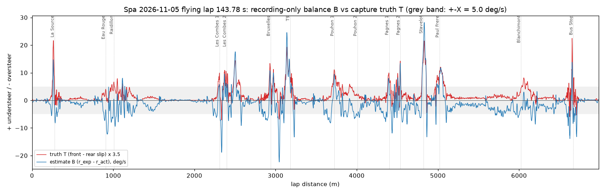

# Oversteer and understeer from a recording (spike, vroom-pnw.15)

**Question:** LMU's recording has no yaw rate, slip angle or lateral velocity. Can under- and oversteer be estimated from
what it does have (steering, speed, lateral g, GPS) well enough to show on the strips and map, and to coach on?

**Answer:** yes for understeer, partly for oversteer. On Spa corners, the recording-only estimate follows the true balance
(front minus rear slip angle, from a shared-memory capture of the same session) with a correlation of **+0.90**.
Understeer marks are right three times out of four and catch nine stretches in ten. Oversteer is harder. Steering leads
the car's rotation at corner entry and exit, so the estimate dips there on a clean lap. Marks are only trustworthy for
large slides (precision 0.93 at a 10 deg/s threshold), and small slides are missed.

## Method

Everything is per metre of the 1 m grid. Code: `frontend/src/lib/carBalance.ts` (app) and `tools/lmu-logger/balance_check.py` (truth check;
same estimate).

1. v = speed (m/s). Skip metres under 15 m/s. Smooth `g_lat` and `steering` with a centred ±4 m mean.
2. **Actual (path) yaw rate**: r_act = v·κ, with path curvature κ = 9.81·g_lat / v² (left +). Lateral g is the
   path's centripetal acceleration (correlation 0.99 with v²·curvature, `docs/lmu-duckdb-schema.md`).
3. **Steering-wheel angle**: θ = −steering · range / 2 (deg, left +). The range is `steering_range_deg` (VM_STEER_LOCK,
   524° for the McLaren GT3).
4. **Per-car calibration on the driver's own laps**: least squares θ = a·κ + b·κ·v² + c. This is the steady-state
   bicycle model, where a is the steering ratio × wheelbase and b is the steering ratio × the understeer gradient. The
   app fits on the two laps of the comparison when they share a car, and on each lap alone otherwise. The truth check
   fits on 27 laps.
5. **Expected yaw rate**: r_exp = v·(θ − c) / (a + b·v²), the rotation this much steering normally produces at this speed.
6. **Balance** B = s·(r_exp − r_act) in deg/s, where s is the sign of the turn: sign(r_act), or sign(r_exp) when
   |r_act| < 2 deg/s. **B > 0 is understeer** (more steering than the rotation it got). **B < 0 is oversteer** (more
   rotation than asked for, or counter-steer).
7. **Marks**: B > 5 deg/s is understeer and B < −10 deg/s is oversteer. A mark needs ≥ 0.5 g of lateral g (oversteer also
   counts on a counter-steer), runs closer than 3 m are merged, and runs shorter than 5 m are dropped.

Because b is fitted, **zero means "this driver's usual balance in this car"**, not a neutral car. A car that understeers
everywhere reads zero. The marks show where the car departed from its usual behaviour, which is what a coach can act on.

## Ground truth

Seven Spa recordings (2026-11-05/06, McLaren GT3 #10, 27 laps) each have a capture of the same session from the
lmu-logger (#94). The recording and the capture share the game clock, so each grid metre has a time. The capture
then gives:

- the true yaw rate `mLocalRot_y`;
- per-wheel slip angles α = atan2(`mLateralGroundVel`, |`mLongitudinalGroundVel`|), where sign checks show α is
  negative in left turns. The front median is 1.9° and the rear 1.3°.
- **truth balance T = α_front − α_rear** (degrees, positive into the turn = understeer).

Matching: grid speed against the capture 0.008–0.015 m/s rms, steering 0.0002–0.0025. 96,555 metres have truth. The
capture's `mPhysicalSteeringWheelRange` reads 0, so the 524° range itself can't be cross-checked.
Command: the docstring of `tools/lmu-logger/balance_check.py`.

## Results

Calibration on 27 laps: a = 2480 deg·m, b = +1.35, c = +0.32°, R² = 0.893. The fixture lap alone in TypeScript gives a = 2695,
b = 0.95, c = 0.48.

**Correlation with the truth on corner metres (|g_lat| > 0.5), Pearson / Spearman:**

| Variant | vs T | R² of fit |
|---|---|---|
| **as shipped** (g_lat curvature, ±4 m, with b) | **+0.90** / +0.61 | 0.893 |
| κ from the GPS line instead of lateral g | +0.87 / +0.68 | 0.814 |
| true yaw rate `mLocalRot_y` instead of r_act | +0.86 / +0.54 | – |
| smoothing ±2 m | +0.91 / +0.64 | 0.889 |
| smoothing ±8 m | +0.89 | 0.898 |
| no b term | +0.75 / +0.66 | 0.826 |
| as shipped, vs T relative to the car's usual balance (T minus its trend of +1.0° per g) | **+0.93 / +0.87** | |

- **The true yaw rate doesn't help.** Replacing the path yaw rate with the capture's real one scores no better. The
  recording loses nothing here, so captures aren't needed for this feature.
- **The b term matters** (+0.75 without it). The car understeers more as speed rises.
- In TypeScript on the fixture lap, the shipped constants give Pearson **+0.886** (`carBalance.spa.test.ts`).

**Noise:**
- On straights (|g_lat| < 0.2), |B| is 0.23 deg/s at the median and 0.77 at the 90th percentile.
- Across laps at the same metre (6 laps within 3 % of the best), the spread is 2.4 deg/s at the median and 7.1 at the
  90th percentile on corners. That spread is real lap-to-lap variation as much as noise.

**Detection on corner metres.** The truth events are T relative to the car's usual balance, beyond its 90th percentile
(understeer, +1.27°) or its 10th percentile (oversteer, −0.86°):

| Threshold (deg/s) | Understeer precision / recall | Oversteer precision / recall |
|---|---|---|
| 2 | 0.55 / 0.92 | 0.16 / 0.98 |
| **5** | **0.74 / 0.89** | 0.57 / 0.86 |
| **10** | 0.99 / 0.70 | **0.93 / 0.16** |

The marks use 5 for understeer and 10 for oversteer. Against raw T (not relative to the car's usual balance), oversteer
at 5 deg/s drops to 0.30 / 0.46, because a GT3 car at the limit almost never has more rear slip than front.

**Where it lights up** (flying lap, 143.78 s):
- **Kemmel straight:** quiet. B averages −0.3 deg/s, worst −3.5 deg/s, under the threshold.
- **Pouhon 1:** understeer on entry (B +9.5 deg/s, T +3.2°).
- **Bus Stop:** both ways, from +14 to −14 deg/s, while T goes from +6.4 to −1.5°. The understeer is real. The oversteer
  half is the chicane's quick direction change, smeared by the ±4 m smoothing.
- The strongest real understeer across all laps is at Stavelot, Fagnes 2, T9 and Pouhon 1 (B +33 to +38 deg/s,
  T +6.5 to +7.7°). The strongest real oversteer is at the Bus Stop (B −52 deg/s, T −11.8°, a slide on the
  2026-11-05 12:07 session's in-lap) and at Bruxelles exit (B −22, T −2.0°).

**Known weakness:** through medium-g corners B runs 3–5 deg/s negative while T is +0.3–1°. Steering leads yaw at entry
and unwinds early at exit, so a steady-state fit reads "more rotation than asked" there. This is why oversteer needs the
higher threshold. A model with the steering's lead (e.g. comparing steering with the g_lat ~0.1 s later) could fix it;
that wasn't tried.

## Prototype

Open the Telemetry page with **`?balance`** in the URL (e.g. `http://localhost:5173/?balance`). Nothing changes
without the flag.

- The **Strips** menu offers *Balance (experimental)*: B for the lap and the reference in deg/s, US + / OS −, marked "exp".
- The **steering strip** gets blue understeer and magenta oversteer marks on the lap's trace, and is labelled "exp".
- The **classic 2D map** tints the line in the same colours, with an "exp" legend. The detailed 2D and 3D views are
  not tinted.

On the Spa mock (lap 4 against lap 3), the understeer marks fall in most of the faster corners, among them Les Combes,
T9, Pouhon, Fagnes, Stavelot and the Bus Stop. A screenshot was not taken: the headless browser
couldn't be installed in this environment.

## Options

1. **Keep as an understeer-first feature.** Build it into the strips and map (no flag), with understeer marks at
   5 deg/s, oversteer only for big slides (10 deg/s), and coach facts per corner ("understeer through Pouhon 1 entry,
   peak 9 deg/s more steering than the car used"). Calibration moves to the backend, over all the driver's laps in
   that car. Cost: small; the code exists. Risk: oversteer misses small slides, and the meaning ("relative to your
   usual balance") must be explained.
2. **Change: model the steering lead first.** Add a lag term to the fit (or compare against g_lat shifted ~0.1 s),
   then re-run `balance_check.py`. If it removes the entry/exit dip, oversteer could use 5 deg/s too. Cost: one more
   spike-sized round. Option 1 can ship while this is tried.
3. **Drop.** Keep the write-up and the truth-check script. Lap-to-lap differences in steering already show on the
   steering strip.

**Recommendation:** option 1, with option 2 filed as a follow-up. Understeer is the most common GT3 balance complaint,
and the estimate catches it reliably from the recording alone, with no capture needed.
