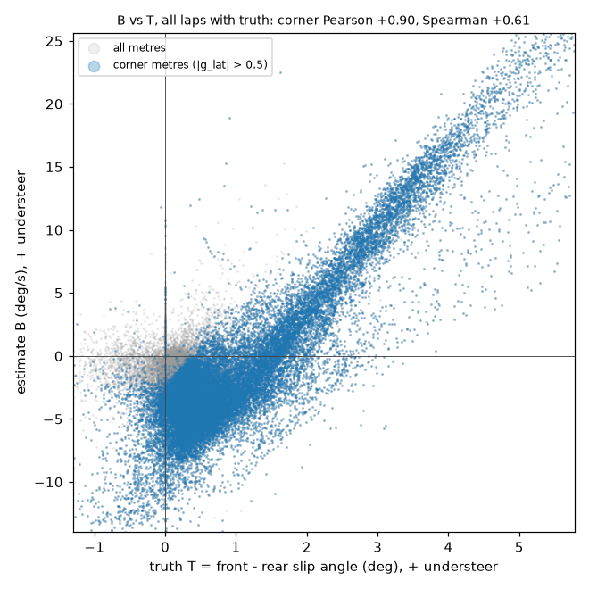

# Oversteer and understeer from a recording (spike, vroom-pnw.15)

**Question:** LMU's recording has no yaw rate, slip angle or lateral velocity. Can under- and oversteer be estimated from
what it does have (steering, speed, lateral g, GPS) well enough to show on the strips and map, and to coach on?

**Answer:** yes for understeer, partly for oversteer. On Spa corners, the recording-only estimate follows the true balance
(front minus rear slip angle, from a shared-memory capture of the same session) with a correlation of **+0.90**.
Understeer marks are right three times out of four and catch nine stretches in ten. Oversteer is harder. Steering leads
the car's rotation at corner entry and exit, so the estimate dips there on a clean lap. Marks are only trustworthy for
large slides (precision 0.93 at a 10 deg/s threshold), and small slides are missed.

## Method

Everything is per metre of the 1 m grid. Code: `frontend/src/lib/carBalance.ts` (app) and `tools/lmu-logger/balance_check.py` (truth check;
same estimate).

1. v = speed (m/s). Skip metres under 15 m/s. Smooth `g_lat` and `steering` with a centred ±4 m mean.
2. **Actual (path) yaw rate**: r_act = v·κ, with path curvature κ = 9.81·g_lat / v² (left +). Lateral g is the
   path's centripetal acceleration (correlation 0.99 with v²·curvature, `docs/lmu-duckdb-schema.md`).
3. **Steering-wheel angle**: θ = −steering · range / 2 (deg, left +). The range is `steering_range_deg` (VM_STEER_LOCK,
   524° for the McLaren GT3).
4. **Per-car calibration on the driver's own laps**: least squares θ = a·κ + b·κ·v² + c. This is the steady-state
   bicycle model, where a is the steering ratio × wheelbase and b is the steering ratio × the understeer gradient. The
   app fits on the two laps of the comparison when they share a car, and on each lap alone otherwise. The truth check
   fits on 27 laps.
5. **Expected yaw rate**: r_exp = v·(θ − c) / (a + b·v²), the rotation this much steering normally produces at this speed.
6. **Balance** B = s·(r_exp − r_act) in deg/s, where s is the sign of the turn: sign(r_act), or sign(r_exp) when
   |r_act| < 2 deg/s. **B > 0 is understeer** (more steering than the rotation it got). **B < 0 is oversteer** (more
   rotation than asked for, or counter-steer).
7. **Marks**: B > 5 deg/s is understeer and B < −7 deg/s is oversteer (−10 until vroom-bi4.7). A mark needs ≥ 0.5 g of lateral g (oversteer also
   counts on a counter-steer), runs closer than 3 m are merged, and runs shorter than 5 m are dropped.

Because b is fitted, **zero means "this driver's usual balance in this car"**, not a neutral car. A car that understeers
everywhere reads zero. The marks show where the car departed from its usual behaviour, which is what a coach can act on.

## Ground truth

Seven Spa recordings (2026-11-05/06, McLaren GT3 #10, 27 laps) each have a capture of the same session from the
lmu-logger (#94). The recording and the capture share the game clock, so each grid metre has a time. The capture
then gives:

- the true yaw rate `mLocalRot_y`;
- per-wheel slip angles α = atan2(`mLateralGroundVel`, |`mLongitudinalGroundVel`|), where sign checks show α is
  negative in left turns. The front median is 1.9° and the rear 1.3°.
- **truth balance T = α_front − α_rear** (degrees, positive into the turn = understeer).

Matching: grid speed against the capture 0.008–0.015 m/s rms, steering 0.0002–0.0025. 96,555 metres have truth. The
capture's `mPhysicalSteeringWheelRange` reads 0, so the 524° range itself can't be cross-checked.
Command: the docstring of `tools/lmu-logger/balance_check.py`.

## Results

Calibration on 27 laps: a = 2480 deg·m, b = +1.35, c = +0.32°, R² = 0.893. The same fit in TypeScript on the
fixture lap alone gives a = 2694, b = 0.95, c = 0.37. One lap is a smaller sample, not a different method: both fit every
metre at ≥ 15 m/s with no wheel off. The thresholds and the precision and recall figures below come from the 27-lap fit.
The app fits on just the two compared laps, so its marks will vary a little more than these numbers suggest.

**Correlation with the truth on corner metres (|g_lat| > 0.5), Pearson / Spearman:**

| Variant | vs T | R² of fit |
|---|---|---|
| **as shipped** (g_lat curvature, ±4 m, with b) | **+0.90** / +0.61 | 0.893 |
| κ from the GPS line instead of lateral g | +0.87 / +0.68 | 0.814 |
| true yaw rate `mLocalRot_y` instead of r_act | +0.86 / +0.54 | – |
| smoothing ±2 m | +0.91 / +0.64 | 0.889 |
| smoothing ±8 m | +0.89 | 0.898 |
| no b term | +0.75 / +0.66 | 0.826 |
| as shipped, vs T relative to the car's usual balance (T minus its trend of +1.0° per g) | **+0.93 / +0.87** | |

- **The true yaw rate doesn't help.** Replacing the path yaw rate with the capture's real one scores no better. The
  recording loses nothing here, so captures aren't needed for this feature.
- **The b term matters** (+0.75 without it). The car understeers more as speed rises.
- In TypeScript on the fixture lap, the shipped constants give Pearson **+0.886** (`carBalance.spa.test.ts`).

**Noise:**
- On straights (|g_lat| < 0.2), |B| is 0.23 deg/s at the median and 0.77 at the 90th percentile.
- Across laps at the same metre (6 laps within 3 % of the best), the spread is 2.4 deg/s at the median and 7.1 at the
  90th percentile on corners. That spread is real lap-to-lap variation as much as noise.

**Detection on corner metres.** The truth events are T relative to the car's usual balance, beyond its 90th percentile
(understeer, +1.27°) or its 10th percentile (oversteer, −0.86°):

| Threshold (deg/s) | Understeer precision / recall | Oversteer precision / recall |
|---|---|---|
| 2 | 0.55 / 0.92 | 0.16 / 0.98 |
| **5** | **0.74 / 0.89** | 0.57 / 0.86 |
| **10** | 0.99 / 0.70 | **0.93 / 0.16** |

The marks used 5 for understeer and 10 for oversteer. vroom-bi4.7 moved oversteer to 7 (0.88 / 0.45; see Steering lead below). Against raw T (not relative to the car's usual balance), oversteer
at 5 deg/s drops to 0.30 / 0.46, because a GT3 car at the limit almost never has more rear slip than front.

**Where it lights up** (flying lap, 143.78 s):
- **Kemmel straight:** quiet. B averages −0.3 deg/s, worst −3.5 deg/s, under the threshold.
- **Pouhon 1:** understeer on entry (B +9.5 deg/s, T +3.2°).
- **Bus Stop:** both ways, from +14 to −14 deg/s, while T goes from +6.4 to −1.5°. The understeer is real. The oversteer
  half is the chicane's quick direction change, smeared by the ±4 m smoothing.
- The strongest real understeer across all laps is at Stavelot, Fagnes 2, T9 and Pouhon 1 (B +33 to +38 deg/s,
  T +6.5 to +7.7°). The strongest real oversteer is at the Bus Stop (B −52 deg/s, T −11.8°, a slide on the
  2026-11-05 12:07 session's in-lap) and at Bruxelles exit (B −22, T −2.0°).

**Known weakness:** through medium-g corners B runs 3–5 deg/s negative while T is +0.3–1°. Steering leads yaw at entry
and unwinds early at exit, so a steady-state fit reads "more rotation than asked" there. This is why oversteer needs the
higher threshold. A model with the steering's lead (e.g. comparing steering with the g_lat ~0.1 s later) could fix it.
vroom-bi4.7 tried it and it doesn't: see Steering lead below.

## Prototype

Open the Telemetry page with **`?balance`** in the URL (e.g. `http://localhost:5173/?balance`). Nothing changes
without the flag.

- The **Strips** menu offers *Balance (experimental)*: B for the lap and the reference in deg/s, US + / OS −, marked "exp".
- The **steering strip** gets blue understeer and magenta oversteer marks on the lap's trace, and is labelled "exp".
- The **classic 2D map** tints the line in the same colours, with an "exp" legend. The detailed 2D and 3D views are
  not tinted.

On the Spa mock (lap 4 against lap 3), the understeer marks fall in most of the faster corners, among them Les Combes,
T9, Pouhon, Fagnes, Stavelot and the Bus Stop. A screenshot was not taken: the headless browser
couldn't be installed in this environment.

## Options

1. **Keep as an understeer-first feature.** Build it into the strips and map (no flag), with understeer marks at
   5 deg/s, oversteer only for big slides (10 deg/s), and coach facts per corner ("understeer through Pouhon 1 entry,
   peak 9 deg/s more steering than the car used"). Calibration moves to the backend, over all the driver's laps in
   that car. Cost: small; the code exists. Risk: oversteer misses small slides, and the meaning ("relative to your
   usual balance") must be explained.
2. **Change: model the steering lead first.** Add a lag term to the fit (or compare against g_lat shifted ~0.1 s),
   then re-run `balance_check.py`. If it removes the entry/exit dip, oversteer could use 5 deg/s too. Cost: one more
   spike-sized round. Option 1 can ship while this is tried.
3. **Drop.** Keep the write-up and the truth-check script. Lap-to-lap differences in steering already show on the
   steering strip.

**Recommendation:** option 1, with option 2 filed as a follow-up. Understeer is the most common GT3 balance complaint,
and the estimate catches it reliably from the recording alone, with no capture needed.

## Decision (autopilot)

**Keep (option 1, understeer first)**, with option 2 filed as a separate spike that doesn't block the build. Made by
the autopilot judge on 2026-11-17.

- **Usable as a coach fact.** On corners the estimate follows the truth at Pearson +0.90 (+0.93 against the car's usual
  balance). Understeer marks at 5 deg/s score 0.74 precision and 0.89 recall, from the recording alone. That is good
  enough for a fact computed in code (spec goal 2).
- **Fits the v2 importer.** It needs no shared-memory capture: the true yaw rate scored no better. So it can follow the v2
  importer path and doesn't wait for v3.
- **Small cost.** The estimator, its tests and the truth check exist. Another spike round would hold up the agreed order
  for a P3 item.
- **Oversteer stays experimental.** On a clean lap it dips to −12 to −22 deg/s (the steering-lead artefact), and recall at
  10 deg/s is 0.16. It stays experimental and out of the coach's facts until the lag model is tried.
- **Contract first.** Every contract change is written into the matching v2 issue.

Follow-ups filed under Analysis features (vroom-bi4):
- vroom-bi4.5: the balance in the API contract and the mock.
- vroom-bi4.6: the strip, marks and map tint without the flag. Depends on vroom-bi4.5.
- vroom-bi4.7: a spike to model the steering lead for oversteer.

## In the API contract (vroom-bi4.5)

`CompareResponse` carries `lap_balance` / `ref_balance` (deg/s per grid metre, + = understeer, null below 15 m/s or without a
calibration), `lap_understeer_runs` / `ref_understeer_runs` and the experimental `lap_oversteer_runs` / `ref_oversteer_runs`
(`{start_m, end_m}`). `CornerSideMetrics` has `understeer_peak_deg_s` and `understeer_mean_deg_s` (understeer only, no
per-corner oversteer figure). The coach's evidence quotes understeer when the lap's peak is ≥ 5 deg/s and ≥ 3 deg/s above the
reference's, and never oversteer. The mock calibrates on the two compared laps (`compareBalance`); the backend calibrates over
all of the driver's laps in that car.

## Steering lead (spike vroom-bi4.7)

**Question:** the estimate dips negative at corner entry and exit on a clean lap, which looked like steering leading the car's
rotation. If a lag model removes that dip, can oversteer marks use 5 deg/s like understeer?

**Answer:** no. The dip isn't a lag artefact, and every lag model makes the estimate worse. The thresholds do show
something else, though: **oversteer at 7 deg/s** nearly triples recall (0.16 → 0.45) and keeps precision close
(0.93 → 0.88).

### What was tried

`tools/lmu-logger/balance_check.py` (section `STEERING LEAD`; same seven Spa sessions, 27 laps, same command) now also
runs the whole fit and estimate with the steering lagged before it meets the path yaw rate, in the fit and the estimate
alike:

- **delay τ**: steering from τ seconds earlier, i.e. at the metre d − v·τ. This is "steering against g_lat about 0.1 s
  later". Negative τ advances the steering instead, as a control.
- **first-order lag τ**: steering through a first-order lag with time constant τ, run along the lap (dt = 1 m / v). This
  is the bicycle model's yaw response to a steering input.

Each variant is scored against the same truth as above (T_dev, the front-minus-rear slip angle relative to the car's
usual balance; oversteer = T_dev below its 10th percentile, −0.86°). The **dip** is measured on the six fast laps (within
3 % of the best) on corner metres where the truth is *not* oversteer: there, any negative B is the artefact. **Marks** are
counted as the app draws them (≥ 0.5 g, runs merged within 3 m, ≥ 5 m long) on those six laps. A mark is real if any of
its metres is true oversteer.

### Before and after

| Steering model | B~T_dev corner P | Clean-corner B p1 / p5 (deg/s) | Share of clean corner metres < −5 | OS precision / recall at 5 | at 10 |
|---|---|---|---|---|---|
| **none (as shipped)** | **+0.929** | **−6.9 / −5.4** | 0.078 | **0.57 / 0.86** | **0.93 / 0.16** |
| delay −0.10 s (advanced) | +0.869 | −9.7 / −6.5 | 0.115 | 0.40 / 0.81 | 0.72 / 0.27 |
| delay −0.05 s (advanced) | +0.917 | −7.9 / −5.8 | 0.095 | 0.50 / 0.88 | 0.91 / 0.21 |
| delay 0.05 s | +0.896 | −7.1 / −5.5 | 0.076 | 0.49 / 0.75 | 0.92 / 0.12 |
| delay 0.10 s | +0.822 | −7.8 / −6.0 | 0.097 | 0.36 / 0.61 | 0.58 / 0.08 |
| delay 0.20 s | +0.613 | −10.7 / −7.8 | 0.149 | 0.22 / 0.48 | 0.13 / 0.06 |
| first-order 0.05 s | +0.897 | −6.9 / −5.4 | 0.069 | 0.50 / 0.76 | 0.93 / 0.11 |
| first-order 0.10 s | +0.836 | −7.3 / −5.6 | 0.081 | 0.40 / 0.67 | 0.57 / 0.07 |
| first-order 0.20 s | +0.692 | −9.1 / −6.9 | 0.120 | 0.27 / 0.55 | 0.15 / 0.06 |

(0.15 and 0.30 s are in the script's output and continue the trend. The fit's R² is highest without a lag too: 0.893, against 0.884 at
0.1 s delay.) Understeer gets worse with any lag as well: 0.74 / 0.89 at 5 deg/s as shipped, 0.71 / 0.86 at 0.1 s delay.

**Why no lag wins:** the truth is an instantaneous slip angle, and so is the estimate. In the linear bicycle model
α_f − α_r = δ − L·r / v, the steering angle minus the yaw rate's share at the same instant. B is that same comparison
at the same instant, with a speed-dependent gain. Shifting the steering in time breaks the match. The lag between steering
and yaw is real, but it is already *in* the truth: on turn-in the front slips before the car rotates, and the truth sees that too.

**The dip is mostly real.** By corner phase on the six fast laps (entry = |g_lat| rising over ±5 m, exit = falling):

| Phase | Metres | B mean / p5 (deg/s) | T_dev mean / p5 (deg) | Share true oversteer | B~T_dev P |
|---|---|---|---|---|---|
| entry | 5,617 | −0.58 / −6.4 | −0.08 / −1.00 | 0.10 | +0.93 |
| mid | 4,207 | +1.90 / −6.2 | +0.32 / −0.92 | 0.06 | +0.99 |
| exit | 5,805 | −2.13 / −9.4 | −0.23 / −1.39 | 0.17 | +0.94 |

At exit the truth moves the same way as B: the rear slips more as the throttle comes in. Within each phase B still
follows the truth at +0.93 or better. On clean corner metres (truth not oversteer), B passes −10 deg/s on 0.1 % of
metres. So the −12 to −22 deg/s readings quoted in the issue (Bus Stop, Bruxelles exit) are mostly the car rotating more
than usual, not an artefact. A delay only moves the dip: at 0.2 s the exit mean becomes +0.82 but entry drops to −3.10, and
precision collapses.

### What does move oversteer: the threshold

The shipped estimate, at thresholds between 5 and 10 deg/s:

| Oversteer threshold (deg/s) | OS precision / recall (metres) | OS marks on 6 fast laps, real / false |
|---|---|---|
| 5 | 0.57 / 0.86 | 157 / 103 |
| 6 | 0.77 / 0.67 | 121 / 57 |
| **7** | **0.88 / 0.45** | **75 / 28** |
| 7.5 | 0.90 / 0.36 | 53 / 28 |
| 8 | 0.90 / 0.29 | 41 / 25 |
| 10 (as shipped) | 0.93 / 0.16 | 24 / 16 |

7 deg/s sits just past the clean-corner noise: the 1st percentile of B on corner metres without oversteer is −6.9. It
roughly triples the real marks (24 → 75 on six laps) and the recall (0.16 → 0.45), for 12 more false marks (2 per lap). At
5 deg/s, 40 % of the marks are false (17 per lap), so 5 stays out of reach for oversteer. The threshold was picked on the
same 27 laps it is scored on. It is a single number, but a new car or track should be checked with the same script.

### Options

1. **Drop the lag model, lower the oversteer threshold to 7 deg/s.** One constant in `carBalance.ts`
   (`OVERSTEER_MARK_DEG_S`) and the figures in the contract's comment (`types.ts`). Oversteer stays experimental and out of the
   coach's facts. About 5 false marks per lap would show, against 3 today.
2. **Drop the lag model, keep 10 deg/s.** Nothing changes in the app. Only big slides are marked.
3. **Keep looking.** E.g. a threshold in slip-angle terms (B / v) rather than yaw rate, or entry and exit thresholds per
   phase. Nothing here suggests a large gain: B already follows the truth at +0.93 or better within every phase.

**Recommendation:** option 1. The lag model doesn't help (no tested lag beats none), and 7 deg/s nearly triples
oversteer recall for a small loss of precision.

### Decision (autopilot)

**Option 1: drop the lag model and lower the oversteer threshold to 7 deg/s.** Oversteer stays experimental and out of
the coach's facts. The autopilot judge made this call on 2026-11-17.

- **The lag model fails on every measure.** No delay or first-order variant beats no lag. Pearson falls from +0.929 to +0.822
  at 0.1 s delay, oversteer precision at 10 deg/s falls from 0.93 to 0.58, and the fit's R² is highest without a lag. B and the
  truth are both instantaneous slip comparisons, so a time shift breaks the match.
- **The entry and exit dip is mostly real.** The truth moves with B at exit (T_dev mean −0.23°, 17 % true oversteer).
  On clean corner metres B passes −10 deg/s on 0.1 % of metres.
- **7 deg/s is a cheap, large gain.** Recall goes from 0.16 to 0.45 with precision 0.88 (was 0.93), for about 2 more false
  marks per lap. It sits just past the clean-corner noise (p1 −6.9).
- **The risk is small.** Oversteer marks are display-only and experimental, and the coach never gets them (spec: only facts computed in code).

Done in this change: `OVERSTEER_MARK_DEG_S` = 7 in `carBalance.ts` and the `lap_oversteer_runs` comment in `types.ts`.
Follow-up: re-check the threshold on another car or track before oversteer marks lose the experimental label. It was
tuned on the same 27 laps of one car at Spa that it was scored on.
