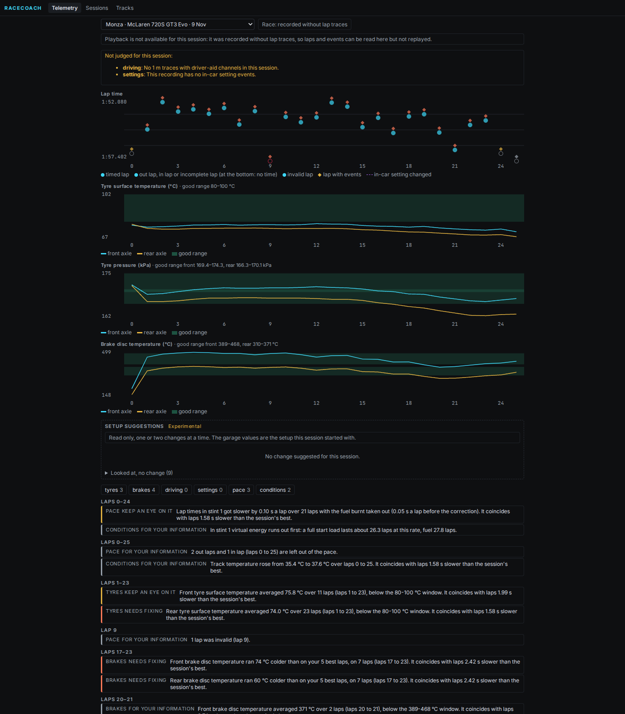

# Setup and driver-aid suggestions from the session report (spike vroom-k5s.2)

**Question:** which setup and driver-aid suggestions can the session report support honestly, and is the recorded `CarSetup` the start or the end setup?

**Short answer:** the report can honestly back two kinds of advice today: **"you changed X in the car and kept it, so put it in the garage"** (certain) and **"try one aid step lower for one run, and compare corner Y"** (an experiment, not a fix). Pressure and brake-duct changes work mechanically, but their windows are partly measured from the driver's own laps, so "in the window" means "like your usual laps", not "right". Camber is folklore-grade. Brake bias is not supported yet, but the data for it exists (see below). On the two real races in the mock (Spa 10 Nov, Monza 9 Nov) the honest answer is **no change**, and the prototype says so.

The prototype is on the Session tab behind `?suggest`, labelled **Experimental**:
`/?session=3ebcd5d2619d62eed2371ee7182a44075c357ae8&suggest` (Monza race), or any lap URL with `&suggest` and the Session tab open.

## Verified facts (new, also in `docs/lmu-duckdb-schema.md`)

All checks ran on copies of the recordings, read-only.

1. **`CarSetup` is the setup at the start of the recording.** 225 of 230 readable recordings start with exactly the setup's fuel (`VM_FUEL_CAPACITY`); the 5 that do not are Race sessions, where the race sets the start fuel. In the Spa race of 10 Nov the RR tyre was changed at the stop (99 % wear afterwards) yet the setup still shows the start "98% Medium". A garage visit starts a **new** recording: consecutive files (Monza practice 6 Nov 21:16 → 21:18, Bahrain practice 17 Nov 01:45:42 → 01:45:59) show the fuel reset to the setup value and the previous file's end tyre wear. So one recording has one start setup, and any advice is "change this from what you started with".
2. **In-car brake bias is recorded,** contrary to the issue's premise. The event table `Brake Bias Rear` holds the rear share (0.4775 = 52.25:47.75), with `Brake Migration` beside it. The first event equals the setup's `VM_BRAKE_BALANCE` in 242 of 246 recordings. 6 recordings have in-car changes (one GT3 click = 0.0025, one Toyota Hypercar click = 0.0045), e.g. Spa practice 10 Nov 20:25 (25 events) and Spa race 16 Nov 01:13 (35). No migration change was seen. `tools/extract-laps.mjs` and the contract's `SettingName` do not carry bias yet.
3. **Tread zones are in the car frame:** the inner edge is the right zone on the left wheels and the left zone on the right wheels. With −2.2° front camber the inner edge is hotter on all four wheels, which only reads right in this frame.

## What maps to what

| Report signal | Setup key(s) | Rule in the prototype | Confidence | Why |
|---|---|---|---|---|
| In-car ABS / TC / TC cut / TC slip kept for the last 2+ laps, off the garage value | `VM_ANTILOCKBRAKESYSTEMMAP`, `VM_TRACTIONCONTROL*MAP` | "Set TC 5 in the garage" | **high** | A fact about what the driver did; says nothing about speed. |
| Hot tyre pressure, timed-lap mean per axle, vs the pressure window | `WM_PRESSURE-W_*` | **Observation** (option 2): cold change = hot gap to the window's middle ÷ the session's own gas-law ratio `(hot+101.3)/(cold+101.3)` | **medium** (window measured from own laps), else low | Arithmetic is sound; the target is not published. |
| Disc temperature mean per axle vs the brake window | `VM_BRAKE_DUCTS`, `VM_BRAKE_DUCTS_REAR` | **Observation**: open/close one step; "Open" + too hot → no change | **medium** / low | LMU publishes no degrees per duct step; same window caveat. |
| Inner minus outer tread temperature per axle (stint stats) | `WM_CAMBER-W_*` | **Observation**: outside 7–12 °C → one step | **low** | 7–12 °C is a general rule of thumb; LMU's guide only says "even"; no load or grip channel. |
| ABS / TC activation coinciding with ≥ 0.1 s lost at one corner | `VM_ANTILOCKBRAKESYSTEMMAP`, `VM_TRACTIONCONTROLMAP` | **Experiment**: one step lower for one run, compare that corner | **low** | Co-occurrence is not cause. TC level and TC cut cannot be told apart, so only the level. One aid at a time. |
| Lock-ups | `VM_BRAKE_BALANCE` | Always "considered: not supported" | — | Lock-ups are not split by axle; bias events not extracted. |

Each suggestion carries the setup key, the start value, the facts with every number listed (the same number guard the report uses), a caveat and a "verify by" line for the next session. At most two are shown; the rest are counted, and every rule that fired no change is listed under "Looked at, no change" with its reason, so "no change" is a visible answer and not silence.

## Findings from running it

- **(a) The report's 0.03 s corner threshold is too low for advice.** At 0.03 s the aid experiment fired on 5 of 8 mock sessions, nearly all on 0.04–0.05 s at one corner: noise. The prototype requires 0.1 s.
- **(b) ABS and TC often share a corner and the same loss** (Monza Bus Stop: 0.11 s for both), because the report attributes the corner's loss to each event. Changing both at once would hide which one mattered, so the prototype picks one aid per session (larger loss first, then more metres active).
- **(c) Spa race 10 Nov: no change.** Hot pressures 173.1 front / 169.2 rear kPa, inside the windows; discs 411 / 333 °C, inside; camber spread 11.2 / 8.9 °C, inside the band; ABS and TC losses 0.05 s, below 0.1 s.
- **(d) Monza race 9 Nov: no change on the means,** but only just: pressures 169.5 / 166.5 kPa sit at the bottom edge of the windows and the rear drifts below late in the stint. The report's low surface-temperature events (74–76 °C) have no single honest setup key: lower pressure, more camber and driving style all fit. This session has no recorded setup, so "current" is empty.
- **(e) The best example is Monza practice 5 Nov:** "Try TC 4 instead of 5 for one run" at Parabolica (0.38 s lost; the best laps had TC active for about 1 m there, the others about 11 m). That is the kind of lead a driver can act on and check.
- **(f) Self-measured windows make pressure and duct advice circular.** The GT3 pressure, carcass and brake windows in `reportWindows.ts` were measured from the driver's own fastest laps, so these rules can only say "unlike your usual fast laps". That is still useful for spotting a bad setup, but not for finding a better one.

## Prior art (summary)

Mostly community guidance, nothing publisher-backed with numbers.

- **Camber:** the LMU wiki's setup guide is qualitative ("even temperatures across inner, middle and outer"; more negative camber = more lateral grip, hotter inner edge, faster wear). The only numeric target found is the general 7–12 °C inner-minus-outer rule. One LMU GT3 writer (Arnout Hoekstra, LMU 1.0) says setup has little control over tyre temperatures in LMU.
- **Pressures:** no cold-to-hot ratio is published for LMU or rFactor 2; the gas law gives about 1.2–1.4 kPa hot per 1 kPa cold, so the prototype learns the ratio from each session's own numbers (Spa race: 136 cold → about 171 hot). No official hot targets; community GT3 cold values are 27–28 psi.
- **Brake ducts:** no LMU figure per step; community advice is "discs too hot all lap → open, too cold → close". LMU 1.4 changed the brake model (surface and core), so older advice may be stale.
- **Brake bias:** front lock-ups → move rearward, rear lock-ups → forward, 0.5–1 % steps (simracingmanual.com). Hypercars have no ABS and migration matters too.
- **TC and ABS:** the LMU wiki defines TC, TC power cut and TC slip; sources disagree on which way slip angle goes, so the prototype does not suggest a slip direction. Lower ABS (GT3 only) = more rotation and lock risk, higher = more stable and longer stops.
- **Tools:** Coach Dave Delta (Setup IQ / Auto Tune) rewrites setups iteratively, method undisclosed; Track Titan and Full Grip Vision advertise AI setup engineers. Nothing public on how they word advice or what they refuse to advise on.

## Options

1. **Keep as is:** all five rules, behind the flag, until the backend exists; then move the rules into `racecoach` and let the coach phrase them. Cheapest, but ships pressure and duct advice whose targets are the driver's own habits, and camber advice from folklore.
2. **Change: keep only what the data can carry (recommended).** Keep the kept-setting rule (high) and the one-aid experiment (low, but checkable), and keep pressure, ducts and camber as **observations** in the "no change" list ("front pressure at the bottom edge of your usual range") rather than as changes, until windows come from more than one driver or a published source. Add brake bias once the `Brake Bias Rear` events are extracted, starting with the kept-setting rule (certain), and per-axle lock-ups later.
3. **Drop:** leave setup advice to v5's conversation with the engineer and keep the report factual. Loses the one clearly useful output (the aid experiment with a "verify by").

**Recommendation: option 2.** It keeps advice where a number backs the direction and turns the rest into observations, which matches the spec's "one or two changes at a time with reasoning" without claiming targets we do not have.

**Decision (2026-11-19): option 2.** The prototype now follows it: the kept-setting rule and the one-aid experiment are the only suggestions; an out-of-range pressure, disc temperature or camber spread is listed under "Observations, not changes yet" with what acting on it would mean (`SuggestionSet.observations` in `setupSuggestions.ts`). Brake bias joins once the `Brake Bias Rear` events are extracted (follow-up 1). Everything stays behind `?suggest`, labelled experimental.

## Draft follow-up issues (if you pick keep or change)

1. **Extract in-car brake bias:** `Brake Bias Rear` and `Brake Migration` events in `tools/extract-laps.mjs`, `SettingName` in `types.ts`, the mock and the Session tab markers; then the kept-setting rule covers bias.
2. **Lock-ups per axle** in the report (front vs rear wheel speed drop under braking), so a bias suggestion has a direction.
3. **Windows that are not self-measured:** published or community targets per car class, or measurements from more drivers; mark which windows are self-measured in the UI.
4. **Before/after for an experiment:** link two sessions (same car and track) and show the tested corner's time and aid metres side by side, so "verify by" is answered by the app.
5. **LMU brake-duct step ladder:** list what steps each car's ducts have (words vs numbers) and whether "Open" is the most open.
6. **Port the rules to the backend** (v2/v5) with the facts packet, so the coach phrases them under the number guard.
