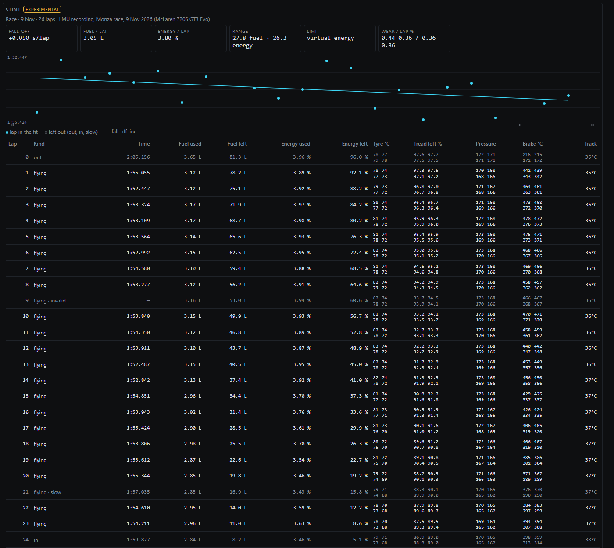

# Stint view: fuel or virtual energy, tyres and lap-time fall-off (spike, vroom-pnw.26)

**Question:** does LMU record enough to show, for each lap of a stint, the fuel or virtual energy used, how the tyres develop
and how lap times fall off? And what would that do to the API contract?

**Answer:** yes, for fuel, virtual energy, tyre temperatures (three zones, carcass, rim), pressures, wear, brake temperatures and
track temperature. All of them are in **every** recording, at 1–100 Hz, GT3 included. A prototype Stint panel on the Sessions page
(labelled EXPERIMENTAL) shows a real 26-lap Monza race from them.

## Channels found

Survey of 244 recordings (all copies, opened read-only), on 2026-11-17. Every file has the same 58 channels and 40 events, whatever
the car (GT3, LMP2, LMP3, Hypercar), because the recorder logs what `UserData/Telemetry/config.json` lists. The full table with
units, rates and quirks is in `docs/lmu-duckdb-schema.md`, section "Stint channels". In short:

| What | Channel | Rate | Usable for the stint view |
|---|---|---|---|
| Fuel | `Fuel Level` (L) | 20 Hz | yes; refuelling shows as a rise |
| Virtual energy | `Virtual Energy` (%) | 20 Hz | **yes, and for GT3 too** (LMU applies the WEC energy rules to LMGT3) |
| Hybrid | `SoC` (%), `Regen Rate` (recorded as kW, really W) | 20 / 100 Hz | Hypercar only; 0 on GT3 |
| Tyre temperatures | `TyresTempLeft/Centre/Right`, `TyresCarcassTemp`, `TyresRubberTemp`, `TyresRimTemp` (°C) | 100 / 5 / 10 / 50 Hz | yes |
| Tyre pressure | `TyresPressure` (kPa) | 10 Hz | yes |
| Tyre wear | `Tyres Wear` (% tread left) | 10 Hz | yes |
| Brakes | `Brakes Temp` (°C), `Brake Thickness` (recorded as %, looks like cm) | 50 / 10 Hz | yes |
| Weather | `Track Temperature`, `Ambient Temperature`, `Wind Speed/Heading` (1 Hz); events `Minimum Path Wetness`, `OffpathWetness`, `CloudDarkness` | | yes |
| Set-up state | events `TyresCompound` (per wheel), `FuelMixtureMap` | on change | names of the values unverified |

**Wheel order FL, FR, RL, RR is confirmed** (until now it was assumed): on the right-handed Monza the left tyres run 4–8 °C
hotter and the front brakes about 100 °C hotter.

## The stint

`Autodromo Nazionale Monza_R_2026-11-09T11_57_06Z.duckdb`: a 26-lap race in the McLaren 720S GT3 Evo, with 24 timed laps and one
pit stop at the end. The longest run in the recordings; no other has more than 12 timed laps.

No Hypercar stint exists yet: the three Ferrari 499P recordings are one invalid practice lap each. They do show that `Virtual Energy`,
`SoC` and `Regen Rate` are recorded for a Hypercar (VE 100 → 93.4 % over the out-lap and part of a lap; SoC cycling 3–100 % within a
lap). A 10-lap Hypercar stint would need a new recording, which only the driver can make.

What the Monza race shows (from `frontend/src/lib/stint.ts` on the extracted file):

| | Value |
|---|---|
| Fall-off | **+0.050 s a lap**, least squares over 21 laps (out, in, invalid and one slow lap left out) |
| Fuel | 3.05 L a flying lap; the 85 L start load lasts 27.8 laps |
| Virtual energy | 3.80 % a flying lap; the 100 % start lasts **26.3 laps, so energy, not fuel, limits the stint** (5.1 % VE and 8.2 L of fuel were left at the stop) |
| Wear | FL 0.44 % a lap, the other three 0.36 % |
| Tyre surface (lap mean) | FL 78 → 82 → 78 °C over the race (it peaks around lap 12 and cools as fuel burns off), FR about 74 → 70 °C |
| Brakes (lap mean) | front about 470 °C early, about 370–400 °C late in the race (rear about 370 → 290–315 °C) |
| Track | 35.3 → 37.6 °C |

The small fall-off is the sum of two effects the recording cannot separate: the car gets lighter (faster) as it burns fuel, and the
tyres wear (slower). On this race they nearly cancel.

## What was built

- `tools/extract-stint.py` (`uv run --with duckdb python -I extract-stint.py <copy.duckdb> <out.json> "<label>"`): per-lap stats
  from a recording. Per lap: official time, kind (out, flying, in, incomplete, from `Lap`, `Lap Time` and `In Pits`), fuel and energy
  at the start and end, lap means of tyre surface (per zone and overall), carcass, pressure and brake temperature, tread left at the
  end, track and air temperature. No driver name is written.
- `frontend/public/mock/monza-stint-2026-11-09.json` (27 KB): that file for the Monza race. It is served only by the mock (the
  build strips `mock/`).
- **Experimental contract:** `Api.stints(): Promise<Stint[]>` (`GET /api/experimental/stints`), with `Stint` and `StintLap` in
  `frontend/src/api/types.ts` under an EXPERIMENTAL heading. The mock serves the one stint, attached to the Monza track and the
  720S (the mock's sessions list does not have the race itself: its 1 m traces would be about 15 MB).
- `frontend/src/lib/stint.ts` (unit-tested, including on the real file): consumption per lap (null across a refuel), wear per lap,
  which laps go into the fit (out, in, incomplete, invalid, and laps more than 2 % slower than the median are left out), the
  least-squares fall-off, the tank range for fuel and energy, and which one runs out first.
- `frontend/src/components/StintPanel.tsx`: shown at the bottom of the Sessions page when the selected track and car have a stint
  (Monza · McLaren 720S GT3 Evo). Summary cards, the lap-time-against-lap-number chart with the fall-off line, and a table per lap
  (time, fuel and energy used and left, tyre surface temperature, tread left, pressure and brake temperature as FL FR / RL RR).

## Contract options

The prototype's `stints()` list is a spike shortcut. For the real backend:

1. **Per-lap stats on `LapMeta`.** Replace the free-form `conditions: Record<string, number>` (which the mock fills with made-up
   `fuel_l` and `tyre_wear`) with a typed `stint: StintLapStats | null`. No new endpoint, and the Telemetry page could show a lap's
   fuel and tyre state too. But every lap list carries about 30 more numbers per lap, whether the page needs them or not.
2. **A per-session endpoint, `GET /sessions/{id}/stints`**, returning the session's laps split into stints at each pit stop, each lap
   with its `lap_id` and the `StintLap` stats. Fetched only by the Stint view; splitting at pit stops is computed once in the
   backend, where it can be tested. One more endpoint to keep in step with the mock.
3. **Both:** a few typed headline values on `LapMeta` (fuel and energy used, tyre wear) and the detail on the endpoint.

**Recommendation: option 2.** The stint is a session-level view, its data is only needed there, and splitting into stints is the
backend's job. `conditions` should become typed or go away at the same time (vroom-9ki), since the mock's values in it are
invented. Keep the view; build it on option 2 in the v2 backend and on the mock first.

Things the prototype does not try, for later issues if the view is kept: a fuel-corrected fall-off (needs a fuel-weight effect per
car, which the recordings don't give), a Hypercar stint (needs a recording), and per-zone tyre temperatures in the table (in the
data as `tyre_zones_c`, not shown).

## Decision (autopilot)

**Keep**, built on **contract option 2** (`GET /sessions/{id}/stints`, the session's laps split into stints at pit stops). The
experimental `Api.stints()` is replaced in the build issue. Decided 2026-11-17 by the autopilot judge (Opus), standing in for the user.

- The Analysis features epic names a stint view, and the spike settled the spec's open question: fuel, virtual energy, tyre and
  brake channels are in every recording, GT3 included.
- The prototype works on a real 26-lap race, and `lib/stint.ts` is pure and tested, in line with "facts computed in code".
- Option 2 keeps `LapMeta` lean; the view is session-level and splitting at pit stops belongs in the backend, where it is tested.
  Option 3 adds two places to keep in step for no current consumer.
- `LapMeta.conditions` carries invented `fuel_l` and `tyre_wear` in the mock, so the build types it or removes it.
- The contract stays sim-agnostic (energy in percent, FL/FR/RL/RR wheels, no LMU names).

No Hypercar recording issue: virtual energy is already shown on GT3, and SoC and regen are confirmed present. Fuel-corrected fall-off
is parked as an idea.
