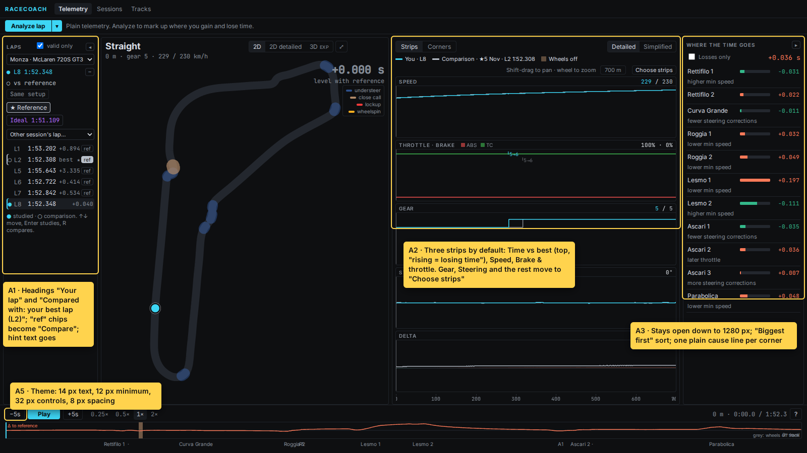
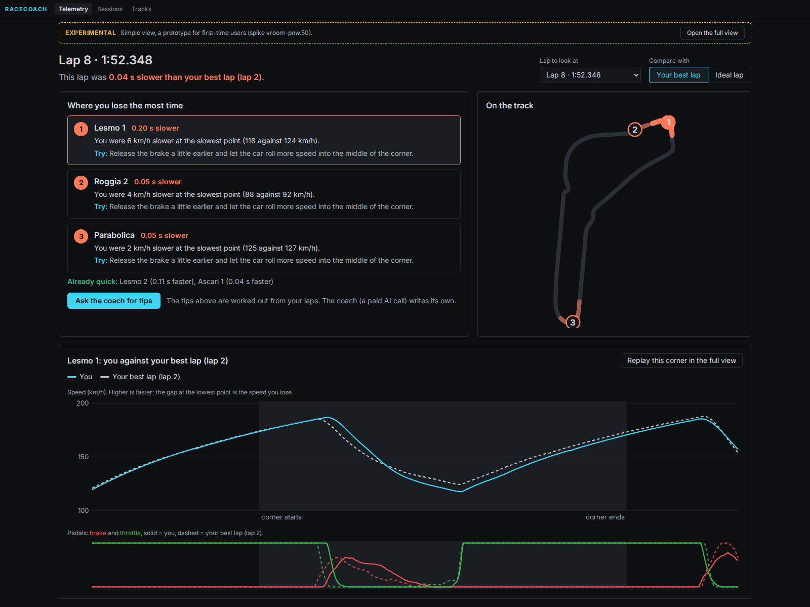
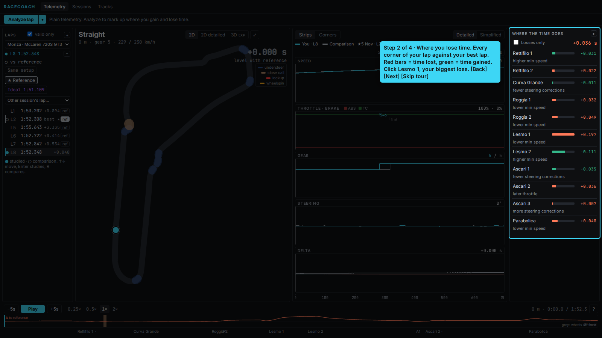

# UI review for a first-time user (spike vroom-pnw.50)

**Question.** What does the app look like to someone with little background in sim racing telemetry, and what would make it simpler and easier to read for them?

**Short answer.** This user can find their slowest corner, but only on a wide screen and only by scanning a list. They can't find *what to do about it* without guessing that a paid "Analyze lap" button is the next step. On a 1366 px laptop, the list that answers "where am I slow" starts collapsed. The page shows about 74 controls, 5 strips and 3 separate colour keys at once. 54 % of its text is 9–11 px, and 60 of the 74 controls are under 24 px in one dimension. The vocabulary (reference, delta, ideal, theoretical, min speed, stint, fall-off) assumes a MoTeC user.

Recommended direction: **B, a Simple view**: one plain-language page answering "where do I lose the most time, and what should I try", at larger sizes, with a link to the full view. It ships together with the token and wording fixes from direction A. A clickable prototype runs behind `?ui=simple`.

## How the review was done

- **Persona.** Someone who drives Le Mans Ultimate casually and wants to get faster, but has never used a telemetry tool (no MoTeC, no Garage 61). They know braking, throttle and a racing line. They don't know what a delta trace, a reference lap, a stint, understeer marks or a distance grid are. They open the app to answer "where am I slow, and what should I do about it?".
- **Tools.** I scripted Playwright 1.49 (the repo's pinned devDependency) against `npm run dev` with the mock API on its own port, using headless Chromium with software WebGL. The setup matches `npm run shots`, but with clicks between shots. Pages were shot at 1600×900, 1366×768 and 2560×1440, with `?debug=0` (the production view). Sizes were **measured from the rendered page**: one script walked every visible element with text and every control, and recorded its computed font size, its box in CSS px, and its WCAG contrast ratio against the nearest opaque background. Canvas text (strip labels, gear shifts) isn't in the DOM, so those sizes come from the source.
- **Reviewers.** Four Opus subagents each got the persona, their area's screenshots, the measurements and the vroom-pnw.30 findings (F1–F34): (1) first open, lap rail, corner rail, playback, window sizes; (2) strips, Strips menu, shading, Key, Corners table, Simplified view, shortcuts; (3) the coach; (4) track views, Sessions, Stint, Tracks. This document merges, de-duplicates and ranks their findings. Anything still visible from vroom-pnw.30 is marked "covered by F*n*", not listed as new.
- **Data.** The mock serves Monza (McLaren, practice of 5 Nov), the Monza race of 9 Nov (stint stats only) and Spa. The mock has no driver name, and none appears in any screenshot.

### Coverage

| Page / flow | Reviewed | Screenshot |
|---|---|---|
| Telemetry, first open with no guidance | yes | [01](img/novice-01-first-open.png) |
| Lap rail; picking a lap and a comparison; Ideal quick pick | yes | [01](img/novice-01-first-open.png), [12](img/novice-12-ideal.png) |
| Corner rail "Where the time goes" and a corner click | yes | [01](img/novice-01-first-open.png), [04](img/novice-04-corner-click.png) |
| Playback, transport, scrubber | yes | [04](img/novice-04-corner-click.png), [05](img/novice-05-analyzed.png) |
| Strips, Strips menu, shading (vroom-pnw.49) | yes | [05](img/novice-05-analyzed.png), [08](img/novice-08-choose-strips.png) |
| Corners tab, Simplified view, shortcuts | yes | [09](img/novice-09-corners-tab.png), [10](img/novice-10-simplified.png), [11](img/novice-11-shortcuts.png) |
| Coach: Analyze, Average, card, "Ask about this corner" | yes | [05](img/novice-05-analyzed.png), [06](img/novice-06-card-ask.png), [07](img/novice-07-average.png) |
| Track views: classic 2D, detailed 2D, 3D | yes (3D chase only; the other cameras were covered in vroom-pnw.30 and are expert features) | [01](img/novice-01-first-open.png), [13](img/novice-13-detailed-2d.png), [14](img/novice-14-3d.png) |
| Sessions, Ideal lap breakdown | yes | [15](img/novice-15-sessions.png), [16](img/novice-16-sessions-stale.png) |
| Stint view (Monza race) | yes | [17](img/novice-17-stint.png) |
| Tracks | yes | [18](img/novice-18-tracks.png) |
| Laptop 1366×768 and large 2560×1440 | yes | [02](img/novice-02-laptop-1366.png), [03](img/novice-03-large-2560.png) |
| The analyzing state (spinner, Cancel) | **out of scope**: the mock answers instantly, so it couldn't be captured. The code shows "Analyzing… Ns" with Cancel (F26 fixed). | — |
| Phone widths | **out of scope**: the persona uses the app next to the sim on a PC; vroom-pnw.30 covered 420 px (F34) | — |

## The first five minutes

Walking the persona through the Monza lap at 1600×900:

1. **The page opens** on lap 8 at 0 m on the main straight ([01](img/novice-01-first-open.png)). The largest number on screen is a grey **"+0.000 s level with reference"**, and every strip is a flat line. *Stuck:* the first thing they read says they are on pace, or that nothing has loaded. The only hint is "Plain telemetry. Analyze to mark up where you gain and lose time", which promises something the right-hand rail already shows.
2. **The corner rail** lists 11 corners in track order. The Lesmo 1 bar (+0.197) is the longest red one, so after scanning they find their slowest corner in about 15 s. *At 1366 px the rail starts collapsed* to a thin vertical "Corners" tab ([02](img/novice-02-laptop-1366.png)), and most laptop users stop here.
3. **They click Lesmo 1.** The playhead jumps to 2,234 m, and the readout title, the map position and the ENGINEER line all say **Roggia 2** ([04](img/novice-04-corner-click.png)). *Stuck:* did it go to the wrong corner?
4. **"lower min speed"** is the cause line. It is a symptom in jargon, not an action. The strips show two near-identical speed lines in a 1125 m window, with nothing marking which dip matters. *Stuck:* nothing on the page says what to do.
5. **They may try Analyze lap.** It works, and the rail then shows "Carry a little more speed to the apex and stay smooth on the way in" under Lesmo 1 ([05](img/novice-05-analyzed.png)). But nothing said beforehand that this button gives advice, or that it costs money ("Coach cost $0.013" appears afterwards).

**Verdict:** they find the slowest corner without help on a wide screen, but not a fix. On a laptop they don't find either.

## Findings, ranked

Severity: **blocker** (the persona can't get value from the screen), **major** (costs real time or trust), **minor**. "Covered" means a vroom-pnw.30 finding that still shows; those are listed for completeness, not as new work.

| # | Page | Sev. | What the user sees | Why it hurts this persona | Suggested fix |
|---|---|---|---|---|---|
| N1 | Sessions | **blocker** (fixed) | After switching to Spa, Monza's lap table and corner breakdown stay on screen, and "Selected session · 3 Nov" is pushed below them ([16](img/novice-16-sessions-stale.png)). | They study the wrong track's numbers. | Distinct React keys. **Filed and shipped during this review as vroom-pnw.51.** |
| N2 | Telemetry | major | There is no visible way to "what should I do". Before Analyze the rail gives symptoms only ("lower min speed", "later throttle"). The hint text doesn't say Analyze gives advice or that it is a paid call ([01](img/novice-01-first-open.png)). | The persona's main question goes unanswered unless they guess. | Plain-language tips computed from the corner metrics, shown before any LLM call. Label the coach button by what it gives ("Ask the coach for tips") and say it is a paid AI call. |
| N3 | Telemetry · 1366 px | major | Below 1400 px the corner rail starts collapsed to a vertical "Corners" tab, which shares its name with the Corners input tab ([02](img/novice-02-laptop-1366.png)). | On the most common laptop size, the answer to "where am I slow" is hidden. | Keep the rail open down to 1280 px and narrow the map instead (or collapse the lap rail first). Name the tab "Where the time goes". |
| N4 | Telemetry · corner click | major | Clicking "Lesmo 1" seeks to a lead-in inside Roggia 2. The title, map dot and ENGINEER line name Roggia 2, and Play keeps saying it ([04](img/novice-04-corner-click.png)). | They clicked their worst corner and the app names a different one. | While the playhead is in a clicked corner's lead-in, title the readout "Approaching Lesmo 1". The ENGINEER line follows the selection. |
| N5 | Telemetry · first open | major | It opens at 0 m: a grey "+0.000 s level with reference" and flat strips, while the rail says +0.036 s ([01](img/novice-01-first-open.png), [03](img/novice-03-large-2560.png)). | The first number they read is misleading. | Open on the biggest-loss corner with the strips fitted to it, or show the lap gap until playback moves. *Opening position covered by F2.* |
| N6 | All | major | **Text is small and dense.** Of the text elements on the home page, 4 are 9 px, 39 are 10 px, 53 are 11 px and 79 are 12 px. Only 3 are larger (18 px title, 22 px delta). Section titles, strip titles, the corner rail's cause line, lap gaps and scrubber labels are 9–11 px. | 54 % of the text is below the 12 px body size. A novice has to read every word, not glance at familiar layouts. | New tokens (below): 14 px body, 12 px minimum, no 9–10 px text. |
| N7 | All | major | **Hit targets are small.** 60 of 74 controls are under 24 px in one dimension (median height 22 px). Examples: "ref" chips 24×14, "⋯" 18×16, rail collapse 17×16, scrubber corner ticks 7–71×12, checkboxes 13×13, "Choose strips" 88×18, window button 51×18, "▾ More analyses" 21×23. | Below WCAG 2.2's 24 px minimum target (2.5.8), and fiddly for someone who isn't sure what a control does. | 32 px controls, 24 px minimum for inline chips, 36 px rail rows. |
| N8 | Telemetry · strips | major | 5 strips with about 11 traces, about 10 hues and about 35 numbers on screen at Roggia (header readouts, 14 gear-shift labels, axis ticks, "1125 m") ([05](img/novice-05-analyzed.png)). The Delta strip, the one that answers "where am I slow", is last and has no note on direction. | Too much at once for day one. Shift labels like "3→2" are noise to them. | Default to 3 strips: Time vs best (top, captioned "rising = losing time"), Speed, Brake & throttle. Everything else goes in Choose strips. Hide shift labels unless Gear is shown. |
| N9 | Telemetry · shading | major | The coach-corner bands (yellow/red/green, full height) sit behind the red brake trace, red ABS shading and the red delta fill. ABS and TC are explained only in hover tooltips and a 10 px key ([05](img/novice-05-analyzed.png)). | "The coach flagged this corner" and "the brakes locked" look the same. The vroom-pnw.49 explanations go unseen because a novice doesn't hover swatches. | Neutral corner bands (outline or top tick); ABS/TC as thin marks under the trace; a visible "What am I looking at?" link. |
| N10 | Telemetry | major | **Three separate keys:** the map legend (understeer, close call, lockup, wheelspin), the strip legend (You, Comparison, Wheels off, Coach corner), and the Key popover (1 ! ✓ ~, FEEL, LANDMARK), which exists only after Analyze. | They have to assemble the vocabulary from three places, one of them behind a paid call. | One Key, always present, covering map, strips and coach marks. |
| N11 | Telemetry · lap rail | major | "L8 1:52.348", "○ vs reference", "★ Reference", "Ideal 1:51.109", "ref" on every row, "best ★", "+0.894" and "● studied · ○ comparison. ↑↓ move, Enter studies, R compares." ([01](img/novice-01-first-open.png)). | Nothing says "you are looking at lap 8 and comparing it with lap 2, your fastest". | Headings "Your lap" and "Compared with: your best lap (L2)"; "Compare" chips; drop the key hint (it is in the shortcuts popover). *Partly covered by F27.* |
| N12 | Telemetry · card | major | The card says "minimum speed 118 km/h against 124 on the reference", and its mono evidence line reads "peak brake 67% / 68% · throttle pickup at the apex / at the apex". Tags are 9 px ("COSTING TIME", "FEEL") ([06](img/novice-06-card-ask.png)). | "Against the reference" means nothing to them, and the evidence line doesn't say which number is theirs. | "You 118 km/h, your best lap 124 km/h". Put the evidence behind "Details". Tags at 11 px or more. *FEEL covered by F25.* |
| N13 | Telemetry · Ask | major | After "Ask about this corner", the answer repeats the card's text and is added to the rail as well. The page grows past 900 px, which pushes the transport and scrubber below the fold ([06](img/novice-06-card-ask.png), [07](img/novice-07-average.png) after Average). | The paid answer looks like a duplicate, and the player controls vanish. | The rail scrolls inside its own panel; answers collapse to one line with "more". |
| N14 | Telemetry · coach | major | Only 3 of 11 corners get advice. Parabolica (+0.048) and Roggia 1 (+0.032) get none, while Roggia 2 (+0.049) gets a "minor" ([05](img/novice-05-analyzed.png)). | Every red bar reads as a problem, and they can't tell why some are skipped. | State the rule ("advice for the 3 biggest") or add a muted "small, not worth chasing yet" line. |
| N15 | Telemetry · map | major | The issue badge "1" sits on top of the big "+0.050 s behind reference" readout, and its caption runs under the track line ([05](img/novice-05-analyzed.png)). | The most important number is covered by the coach's own mark. | Reserve a clear zone for the readout, or put it on a solid chip. *Similar to F21 (3D).* |
| N16 | Sessions | major | One concept has four names: "Ideal 1:51.109" (rail), "Theoretical" (table, chart), "Gap to theoretical" (card), "Δ ideal" (column) ([15](img/novice-15-sessions.png)). | They assume these are different numbers. | One plain term everywhere: "best possible lap". |
| N17 | Stint | major | "FALL-OFF +0.050 s/lap", "LIMIT virtual energy", "WEAR / LAP 0.44 0.36 / 0.36 0.36 %", a fuel-corrected formula with s/kg, and four stacked tyre values per cell without FL/FR labels ([17](img/novice-17-stint.png)). | Engineer maths with no conclusion they can act on. | Lead with one sentence ("You slowed about 0.05 s a lap as the tyres wore; energy runs out first, after about 27 laps"). Put the formula behind "How is this worked out". Add a 2×2 tyre key. |
| N18 | Tracks | major | The whole page is landmark calibration: Alt-click to add, Confirm/Delete on 40+ rows, "Re-calibrate from ★ reference" ([18](img/novice-18-tracks.png)). | Not a driving task, and a newcomer may delete data. | Move it behind an "Advanced" control on the Tracks page (the spec rules out a Settings page in v1). For day one, Tracks is a labelled map. *Partly covered by F33.* |
| N19 | Track views · detailed 2D | major | On Monza (no edge survey) it shows a dashed line, a cyan line and a 6 px car on black ([13](img/novice-13-detailed-2d.png)). | It looks empty or broken. | Say "Track edges not surveyed for Monza", or hide the view where it has nothing to add. *Partly covered by F30.* |
| N20 | Telemetry · 2560 px | minor | Nothing scales: 10–12 px text, a ~150 px lap rail, 1,800 px-wide strips, and a map with large empty margins ([03](img/novice-03-large-2560.png)). | Hard to read from a sim-rig seat. | Scale the base font with the viewport above 1920 px (e.g. `clamp(14px, 0.6vw + 6px, 16px)`). |
| N21 | Telemetry · corner rail | minor | Rows are in track order only. The biggest loss is found by comparing bar lengths. | "Slowest corner first" is this persona's question. | A "Biggest first" sort, or a "Biggest loss: Lesmo 1" line at the top. |
| N22 | Telemetry · Choose strips | minor | Lateral g, Longitudinal g, Suspension, Tyre slip and "Balance (understeer, exp)" with no description ([08](img/novice-08-choose-strips.png)). | They can't tell which strip answers which question. | A one-line description under each, and "Basics" vs "Advanced" groups. |
| N23 | Telemetry · Corners tab | minor | Ten metric columns, the last one cut off, and signs mean different things per column (−0.031 green = gain, −22 = brake %, −3.5 = km/h) ([09](img/novice-09-corners-tab.png)). | Unreadable for this persona. | By default Corner, Time lost and a cause in words; the rest behind "More columns". *Overflow covered by F17.* |
| N24 | Telemetry · Simplified | minor | Wheels and pedal bars are clear, but there is no delta or corner name, and the "BRK THR" labels are 9 px ([10](img/novice-10-simplified.png)). | It is the friendliest view, but it answers no coaching question. | Add the current gap and corner name, and spell out Brake and Throttle. |
| N25 | Telemetry · shortcuts | minor | 24 shortcuts in 5 groups, with "Scrub", "playhead" and "Pan the traces" ([11](img/novice-11-shortcuts.png)). | Overwhelming on day one. | The playback group first, the rest under "More". |
| N26 | Telemetry · Ideal | minor | "Ideal 1:51.109" is a purple button with no tooltip. Picking it reorders the rail: Rettifilo 1 becomes +0.685 "earlier braking" ([12](img/novice-12-ideal.png)). | "Ideal" sounds like a target someone else set, and the persona doesn't know it is their own best corners stitched together. | "Best possible lap", with a tooltip saying it joins their best corners. |
| N27 | Telemetry · totals | minor | "Lap Δ +0.040 s" in the bar, "+0.036 s" at the top of the rail. | Two numbers for one gap. | Label the rail one "sum of corners", or show the lap gap. *Covered by F5.* |
| N28 | Telemetry · scrubber | minor | "RoggiaR2", "grey: wheels off track" printed over "0 · level", and 7×12 px "·" corner targets ([01](img/novice-01-first-open.png)). | It looks broken. | *Covered by F9.* |
| N29 | Telemetry · Analysis bar | minor | "▾" (21×23 px) opens a menu with one item, "Average (session consistency)". The Focus line has a dotted border that looks like a focused input ([05](img/novice-05-analyzed.png)). | Easy to miss; unclear state. | A labelled "Check consistency across laps" button; plain text for Focus. |
| N30 | Sessions | minor | The Segments column is ~60 px of 1–2 px ticks, and the trend chart is 90 % empty with two sessions ([15](img/novice-15-sessions.png)). | Unreadable, and the headline graphic says nothing. | "Lost most at: Lesmo 1, Roggia 2" instead of ticks; a sentence instead of a chart below 3 sessions. *Partly covered by F32.* |

**What works for this persona** (keep it in any direction): the corner rail's bars (red/green by size) are the fastest route to "where am I slow"; coach fixes slotted under their corner; plain-colour You/Comparison lines; good contrast throughout (muted text is 5.8:1, body 13.9:1); the 3D view stays behind "EXP".

## Measured sizes against a target

Measured at 1600×900 from the rendered page (`?debug=0`, Monza lap 8). Contrast is WCAG 2 against the nearest opaque background. The target is for this persona: WCAG 2.2 AA plus comfort sizes for someone reading every word.

| Element | Font | Box (px) | Contrast | Target | Verdict |
|---|---|---|---|---|---|
| Body text, rail rows, buttons | 12 px | — | 13.9 | 14 px | small |
| Section titles ("LAPS", "WHERE THE TIME GOES") | 10 px caps | 137×12 | 5.8 | 12 px | too small |
| Strip titles (SPEED, DELTA…) | 10 px | 36×14 | 5.8 | 12 px | too small |
| Corner rail cause ("lower min speed") | 11 px | 222×14 | 5.8 | 13 px | small |
| Lap gaps ("+0.894") | 11 px mono | 42×14 | 5.8 | 13 px | small |
| Scrubber labels ("Δ to reference", "grey: wheels off track") | 9 px | 92×9 | 7.5 / 5.8 | 12 px | too small |
| Card tags ("COSTING TIME", "FEEL"), "EXP", "BRK/THR" | 9 px (source) | 18×11 ("EXP") | 5.8 | 11 px | too small |
| Map delta readout | 22 px | 140×29 | 5.8 (grey at 0) | 22 px | OK |
| Readout title ("Straight") | 18 px | 203×21 | 13.9 | 18 px | OK |
| Analyze lap (primary) | 12 px | 92×23 | 10.9 | 32 px high | small |
| "▾ More analyses" | 12 px | 21×23 | 10.9 | 32×32 | too small |
| Header tabs (Telemetry, Sessions, Tracks) | 12 px | 55–74×23 | 12.3 / 5.8 | 32 px high | small |
| Track view radios (2D, 2D detailed, 3D) | 12 px | 32–80×21 | 5.8–12.3 | 32 px high | small |
| Lap rail row | 12 px | 148×22 | 13.9 | 32–36 px high | small |
| Lap rail "ref" chip | 10 px | 24×14 | 5.8 | 24×24 | below WCAG 2.5.8 |
| Lap rail "⋯", rail collapse "◂/▸" | 10 px | 18×16, 17×16 | 5.8 | 24×24 | below WCAG 2.5.8 |
| "valid only", "Losses only" checkboxes | — | 13×13 | — | 16×16 in a 24 px label | small |
| Corner rail row | 12 px | 226×41 | 13.9 | 36 px+ | OK |
| "Choose strips", window "700 m" | 11 px | 88×18, 51×18 | 13.9 / 5.8 | 28 px high | too small |
| Transport −5s / Play / +5s | 12 px | 39–64×21–23 | 10.9–13.9 | 32 px high | small |
| Playback speed (0.25×–2×) | 12 px | 26–47×22 | 5.8 | 28 px high | small |
| Scrubber corner ticks | 10 px | 7–71×12 | 5.8 | 24 px high | below WCAG 2.5.8 |
| Shortcuts "?" | 12 px | 24×23 | 13.9 | 32×32 | small |

Totals: 179 text elements and controls; text sizes 9 px ×4, 10 px ×39, 11 px ×53, 12 px ×79, larger ×3. 74 controls, 60 with a side under 24 px, median height 22 px. Contrast passes everywhere (lowest real text 5.8:1). The 1.1:1 the script reported is the native checkbox's own glyph, not text.

### Proposed theme tokens

The current tokens (`src/theme.ts`: 12 px base, 6 px spacing, 4 px radius, 36 px header) suit an expert reading a familiar MoTeC-like layout. For this persona they are a step too small, and many components hard-code 9–11 px below the base. Proposal ("comfortable" scale, used by the prototype):

| Token | Now | Proposed | Note |
|---|---|---|---|
| `fontBase` | 12 px | **14 px** | body, rail rows, buttons |
| new `fontSmall` | (9–11 px hard-coded) | **12 px** | the floor: captions, axis ticks, tags, section titles |
| new `fontTitle` | (18 px) | **16 px** section, **24 px** page | |
| new `lineHeight` | browser default | **1.45** | |
| `pad` / `gap` | 6 / 6 px | **8 / 8 px**, card padding **16 px** | |
| `radius` | 4 px | **6 px** | |
| new `control` | ~22 px | **32 px** controls, **24 px** minimum for inline chips | WCAG 2.2 2.5.8 |
| `headerHeight` | 36 px | **44 px** | |
| `muted` colour | #868E99 (5.8:1) | **#9AA3AE** (7.5:1) | more of the text is muted at 12 px |
| above 1920 px | fixed | `clamp(14px, 0.6vw + 6px, 16px)` base | 2560 px windows |

Dark-only (a spec non-goal: no light theme), the colour roles and the dense character of the full view stay. The step is one size up, not a different design.

## Jargon and plain-language replacements

| As shown | Where | Plain replacement |
|---|---|---|
| reference, ★ Reference, vs reference | lap rail, readout, card | "your best lap (L2)", "Compared with" |
| ref (chip on each lap) | lap rail | Compare |
| ● studied · ○ comparison. ↑↓ move, Enter studies, R compares. | lap rail | ● your lap · ○ the lap you compare with |
| valid only | lap rail | Hide laps with track-limit cuts |
| Ideal 1:51.109, Ideal lap, Δ ideal, Laps against the ideal | lap rail, Sessions | Best possible lap (your best corners joined) |
| Theoretical, theoretical best, Gap to theoretical | Sessions | Best possible lap; "time left on the table" |
| Δ to PB, Δ best | Sessions | slower than your best by |
| Other session's lap… | lap rail | Compare with another day… |
| level with reference / behind reference / reference 2 m ahead | map readout | same pace as your best lap / 0.05 s slower here / your best lap is 2 m ahead |
| Lap Δ | Analysis bar | Lap time vs your best |
| Δ to reference | scrubber | Time gained or lost vs L2 |
| DELTA | strip title | Time vs best (rising = losing time) |
| lower / higher min speed | corner rail | slower / faster at the slowest point of the corner |
| more / fewer steering corrections | corner rail | more / less sawing at the wheel |
| later throttle, earlier braking | corner rail | back on the throttle later, braked earlier |
| Comparison · ★5 Nov · L2 1:52.308 | strip legend | Your best lap (5 Nov, 1:52.308) |
| Coach corner | strip legend | Corner the coach commented on |
| ABS / TC | pedal strip | ABS working / traction control cut the throttle |
| Wheels off | strip legend | Off track |
| Shift-drag to pan · wheel to zoom; 700 m | strips | Drag to move along the lap · scroll to zoom; "Zoom: 700 m" |
| Lateral g / Longitudinal g | Choose strips | Cornering force / braking & acceleration force |
| Tyre slip / Suspension | Choose strips | Wheel slip / suspension travel |
| Balance (understeer, exp), understeer | Choose strips, map | Car pushing wide (experimental) |
| close call | map legend | nearly off track |
| Peak brake %, Coast s, Overlap s, Steer corr., Min speed at | Corners table | Hardest braking, time off both pedals, time on both pedals, steering corrections, slowest point |
| Detailed / Simplified | inputs | Graphs / Wheel & pedals |
| 2D detailed, 3D EXP | track view | Close-up, 3D (beta) |
| 1 issue · 1 minor · 1 strength · 3 inconsistent | Analysis bar | 1 big loss · 1 small loss · 1 good corner · 3 corners you drive differently each lap |
| FEEL, LANDMARK, OWN LAP | card, Key | tip, use a trackside marker, copy your better lap |
| COSTING TIME | card | You lose 0.197 s here |
| Average (session consistency) | More menu | Check consistency across laps |
| Re-analyze | Analysis bar | Ask again |
| Ask about this corner | card | Explain this corner in more detail |
| braking reference / turn-in reference | Average fix text | braking marker / turn-in marker |
| Scrub, playhead, Pan the traces | shortcuts | Move along the lap, current position, slide the view |
| stats only | Sessions | numbers only, no replay |
| STINT | Sessions | Race run / long run |
| FALL-OFF s/lap, FUEL-CORRECTED FALL-OFF | Stint | Slowing per lap; tyre wear effect (fuel weight removed) |
| LIMIT virtual energy, ENERGY / LAP % | Stint | Runs out first: energy allowance; energy used per lap |
| WEAR / LAP | Stint | Tyre wear per lap (front left, front right / rear left, rear right) |
| out / in / flying | lap tables | out-lap / in-lap / timed lap |
| confirmed / detected / low; Re-calibrate from ★ reference; Complex | Tracks | checked by you / found automatically / unsure; Re-detect corners; Corner group |

## Directions

### A. Bigger, calmer workspace

Keep today's layout and apply the new tokens app-wide. Cut what is on screen by default: three strips (Time vs best on top, Speed, Brake & throttle); the corner rail open down to 1280 px with a "Biggest first" sort; understeer and close-call marks off until asked; one Key. Do the jargon pass from the table above.

- **Fixes:** N3, N6–N11, N16, N20–N23, N25–N27, and the wording parts of N2, N12 and N17.
- **Cost:** medium. Tokens are one file, but 24 CSS modules hard-code 9–11 px text and 2–4 px paddings, and the canvas strips have their own font sizes. Every page needs a visual check.
- **Risks:** a larger scale costs space. At 1366 px something has to give (map width or lap rail). The expert layout stays, so the first screen is still a dashboard to decode, and N2 (no "what to do" before Analyze) and N4/N5 need their own fixes.

### B. Simple view by default, full view one click away (recommended)

A separate, plain-language page is the default landing: "Lap 8 · 1:52.348. This lap was 0.04 s slower than your best lap (lap 2)." It lists the three corners where you lose the most time, worst first. Each has one sentence on what happened, with both numbers ("You were 6 km/h slower at the slowest point (118 against 124 km/h)"), and a **tip computed from the corner metrics** before any paid call. "Ask the coach for tips" replaces those with the coach's fixes. A numbered map shows where they are, and a large labelled chart shows speed and pedals through the selected corner, you against your best lap. "Open the full view" and "Replay this corner in the full view" lead to today's page. It uses the new tokens throughout.

After "Ask the coach for tips", the coach's fixes replace the computed tips ([23](img/novice-23-simple-after-coach.png)). At a 1366 px laptop size everything that answers the question fits above the fold ([24](img/novice-24-simple-1366.png)).

- **Fixes:** N2, N3, N4 (the corner is named by the user's choice), N5, N6, N7, N8, N10, N11 and N12 (inside the Simple view), and N14 in part (after the coach runs, corners it skipped keep a computed tip labelled "worked out from your laps, not the coach"), N20 (it scales), N21 and N26. N9, N13, N15 and N16–N19 stay for the full view, through A's follow-ups.
- **Cost:** low to medium. The prototype is about 530 lines: one component, one CSS module and a small pure helper (`plainCorner`), all reusing the existing data (`CompareResponse.corners`, the projection, `useCoach`). No contract change. Making it the default needs a remembered "Simple / Full" switch, a landing rule, and tips reviewed by a racer.
- **Risks:** two views to maintain, and a split in vocabulary between them (mitigated by doing A's wording pass on the full view too). The computed tips are rules of thumb from one cause per corner. They must stay conservative, and the coach rules apply to them too (only numbers from the facts, no metre distances); the prototype follows both. Advanced users may find the extra click annoying, so the switch must be remembered per browser. The spec's non-goals say "the UI is dark-only and dense". B keeps dark-only and keeps the full view dense, but the default landing would be roomier. That is a wording question for the spec owner, not a change of goal: the non-goal is about not building a light theme or a Settings page, and B adds neither (the Simple / Full switch is a header toggle, not a Settings page).

### C. Guided first run

A 4-step tour over today's page: (1) your lap and what it is compared with; (2) "Where the time goes", click your biggest loss; (3) read the strips at that corner; (4) Analyze for advice. It is shown once and can be restarted from "?".

- **Fixes:** the discovery part of N2, N3 (the tour can open the rail) and N11 (it explains the terms). Nothing about size, density or jargon on the page itself.
- **Cost:** low to medium (a tour library or ~200 lines; content). Every layout change breaks a step.
- **Risks:** tours are skipped and forgotten. The persona still faces the same dense page on day two, so it treats the symptom.

**Recommendation: B, with A's tokens and wording pass as the follow-ups that bring the full view along.** B is the only direction that answers the persona's question on the first screen without a paid call or a guess. It is cheap because it reuses the data the page already loads. A on its own makes the dashboard easier to read but leaves it a dashboard. C explains the complexity instead of removing it.

## Prototype

- **Where:** `npm run dev`, then `http://localhost:5173/?ui=simple`. A dashed "EXPERIMENTAL" banner names the prototype and links to the full view (the link drops `ui=simple`). Lap changes keep the flag.
- **Code:** `frontend/src/components/simple/SimpleView.tsx` and `Simple.module.css` (local "comfortable" tokens), and `frontend/src/lib/plainCorner.ts` (pure sentences, tips, ranking). `TelemetryPage.tsx` renders the Simple view when `ui=simple` (a plain "Loading…" until the comparison has loaded, so the full page never flashes). "Your best lap" is the fastest valid lap of the session, not the pinned ★ reference. Without the flag the page renders exactly as before.
- **Tests:** `lib/plainCorner.test.ts` (sentences, tips without metres, ranking, gap wording, comparison names) and `components/simple/SimpleView.test.tsx` (the flag shows the labelled view with at most 3 ranked losses and keeps `ui` on a lap change; without the flag the full page renders and no "Experimental" appears).
- **Not done:** remembering Simple vs Full; a landing rule (it shows whatever lap the full page would); tips reviewed by a racer; Sessions and Stint in plain language; the 2560 px clamp; keyboard support beyond Tab.

## Decision question

**Keep, change or drop direction B (a plain-language Simple view as the default landing, with the full view one click away)?**

- **Keep:** file the build issues below. Start with the Simple view as default and the corner-click naming bug.
- **Change:** say which part, for example "Simple view yes, but behind a switch, not the default", or "A's tokens first".
- **Drop:** go with A (or C) only. The prototype is removed and this write-up stays.

## Draft follow-up build issues (for direction B)

| Type | Title | Acceptance |
|---|---|---|
| feature | Simple view: plain-language default landing for the Telemetry page (from the vroom-pnw.50 prototype) | `/` opens the Simple view: lap and gap in a sentence, the 3 biggest losses with a plain sentence and a computed tip, a numbered map, a labelled speed and pedal chart for the selected corner, "Ask the coach for tips". A "Simple / Full" switch in the header is remembered per browser. The full view is unchanged and reachable in one click; "Replay this corner" opens it at the corner. The `?ui=simple` flag goes. Tests. |
| bug | Clicking a corner names a different corner in the readout | After a click on a corner (rail, scrubber, badge), the readout title, map and ENGINEER line name the clicked corner while the playhead is in its lead-in ("Approaching Lesmo 1"). Test with Lesmo 1 on Monza. |
| task | Comfortable theme tokens across the app | `theme.ts` gains `fontSmall`, `control`, `lineHeight` and the new values in novice-review.md. No CSS module hard-codes text under 12 px. Controls are at least 24 px (32 px for buttons). Muted becomes #9AA3AE. Screenshots at 1366 and 1600 show no clipping. Test or lint guard for px font sizes under 12. |
| task | Plain-language pass on labels and tooltips | Every row of the novice-review.md jargon table is applied (or noted as kept, with a reason). One term, "best possible lap", replaces ideal/theoretical everywhere in the UI. Tests updated. |
| task | Full view: fewer default strips, one Key, corner rail open on laptops | Default strips are Time vs best (top, captioned), Speed, Brake & throttle; Choose strips has descriptions in Basics/Advanced groups. One Key popover is always present and covers map, strips and coach marks. The corner rail is open by default down to 1280 px and offers "Biggest first". Tests. |
| task | Coach output: no duplicate answers, page never grows past the window | Corner answers collapse to one line with "more". The corner rail scrolls inside its own panel. After Ask or Average the transport stays visible at 1600×900. Coach badges never cover the map's delta readout. |
| task | Stint and Tracks for newcomers | The Stint view leads with one sentence of conclusions, with the formula behind "How is this worked out" and a 2×2 tyre key. The Tracks landmark editor moves behind an "Advanced" control; the default Tracks page is a labelled map. |

## Decision (autopilot)

**Change** (Opus judge, 2026-11-18): keep direction B, but as a remembered mode, not the default landing. The full view stays dense, with a legibility floor.

Reasons:
- B is the only direction that answers "where am I slow, and what do I try" on the first screen without a paid call. At 1366 px it does this where today's page hides the corner rail (novice-24 against novice-02). It reuses data the page already loads and needs no contract change, so it fits v1 and doesn't delay Analysis features or the backend.
- The app runs locally for one driver. With a Simple/Full switch remembered per browser, which view opens first hardly matters. Keeping the full view as the first-visit default avoids touching the spec's "dark-only and dense" non-goal, which only the owner can reword.
- The computed tips look canned: in the prototype all three corners get the same "Release the brake a little earlier…" tip. They must vary by cause and metric, and be checked by the owner, before anyone relies on them.
- A's full token jump (14 px base, 8 px spacing) would undo "dense" in the full view. A legibility floor fixes the worst of N6 and N7 without that.
- Stint and Tracks for newcomers (N17, N18) can wait. They are parked as an idea (vroom-xg2).

Changes to the direction:
- Simple is a mode of the Telemetry page, picked with a remembered Simple/Full switch in the header. The full view opens on a first visit, with the switch visible. Simple keeps its own roomier local tokens.
- The full view keeps its 12 px base and 6 px spacing, with a floor: no text under 11 px, controls at least 24 px, muted #9AA3AE, and a font clamp above 1920 px.
- The corner rail stays open down to 1280 px. This reverses the "collapsed below 1400 px" part of the vroom-pnw.30 decision.

Follow-up issues filed under vroom-pnw: vroom-pnw.52 (corner click names the wrong corner), .56 (Simple view as a remembered mode, after .52), .53 (legibility floor), .54 (plain-language pass, after .56), .57 (three default strips, one Key, rail open on laptops, after .53), .55 (coach output never grows the page or covers the readout, after .57). Idea parked: vroom-xg2 (Stint and Tracks for newcomers). Earlier during the review: vroom-pnw.51 (stale Sessions tables, shipped).

## Jargon pass (vroom-pnw.54)

The jargon table above is applied to both views, with "best possible lap" as the one term for ideal/theoretical in the UI (rail, Sessions table, cards, chart, mock labels, Simple view). Applied after review: the finding kinds (big loss, small loss, good corner, different each lap) in the bar, Key and card tags; "Check consistency across laps"; strip titles and menu entries; the Corners table headers; the lap rail wording; "Zoom: 700 m"; "Race run".

Kept or left for follow-ups, with reasons:

- **ABS / TC:** the short chips stay; their hover text spells them out (vroom-pnw.49). Visible labels belong to the strips follow-up (N9).
- **Strip legend "Compared with · ★5 Nov · L2 1:52.308":** keeps the lap label, which carries the date and time of another day's lap.
- **"Your best lap" in the two views:** the full view's ★ button means the track and car reference lap (it can be another day's or a pinned lap); the Simple view's button means the fastest valid lap of this session. They coincide in the common case. Unifying them needs a product decision on what the reference is.
- **Map readout "0.05 s slower here", lap rail key hint, out/in/flying tags, Tracks page wording, Stint FALL-OFF / LIMIT / WEAR rows, the 3D cockpit dash text, and coach prose in `mockApi.ts` / `coachFacts.ts` that says "the reference":** not done in this pass. The coach prose is the backend's job to phrase (the LLM only phrases facts); the others are filed as a follow-up.
- **Internal names** (`is_ideal`, `theoretical_best_s`, `IdealBreakdown`): API contract and code names, not UI text.
