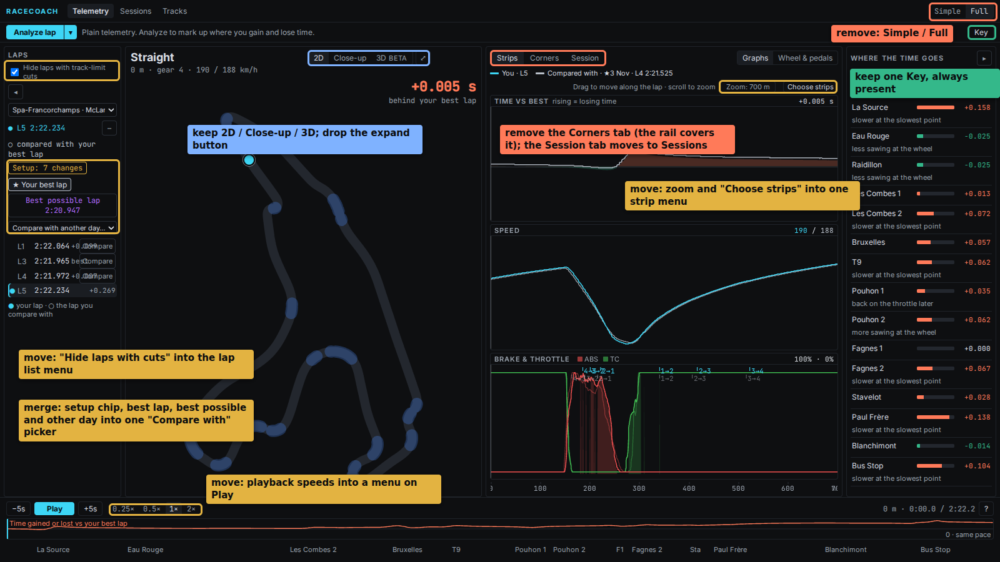
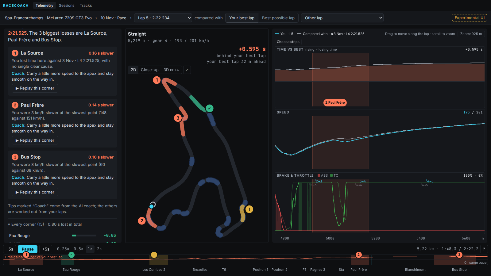
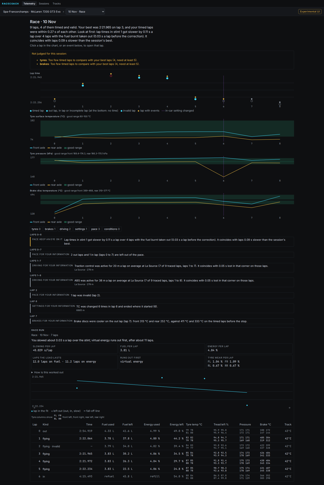
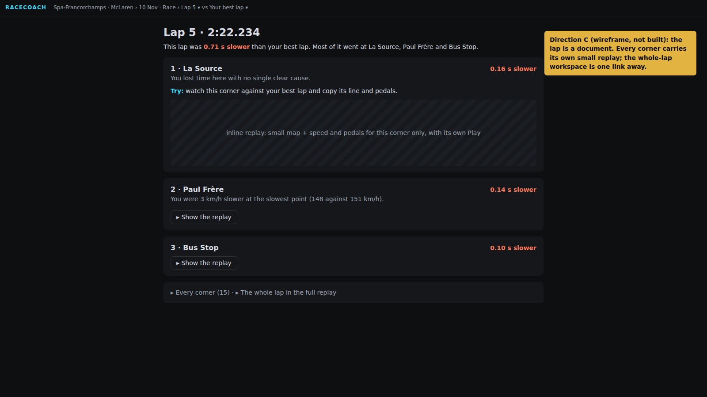

# UI overhaul: one simpler app (spike vroom-pnw.58)

**Question.** What should the app look and feel like so that it is simple by default for everyone, with no Simple mode, and what is the path from today's UI to that?

**Short answer.** The app feels complex because every page shows every level at once, not because any one label is hard. The Telemetry page puts the track and car, the session, the lap and the playhead on one screen, in seven regions of equal weight with 76 controls. Session-level content is split between a tab inside the lap view and the Sessions page. The fix is structural. Give each level one place, and lead each place with its answer in a sentence. That means a **Session** view ("how did the session go, which lap do I look at?") and a **Lap** view ("where did this lap lose time, and what do I try?"). On the Lap view, the plain-language losses, tips and "Replay this corner" from the Simple view lead, and the map and strips are the replay stage beside them. **Recommended: direction B**, with a clickable prototype behind `?ui=one`.

## How the review was done

- **Tools.** Playwright 1.65 (the repo's devDependency) scripted headless Chromium with software WebGL against `npm run dev` with the mock API, on a separate port (5258) so it didn't collide with other worktrees' servers. The setup is the same as `npm run shots`, but with clicks between shots. All shots use `?debug=0` (the production view) and locale en-US. One script walked the rendered page to count controls, control sizes and text sizes.
- **Window sizes.** 1366×768, 1600×900 and 2560×1440 for the Telemetry page, Tracks and the prototype. Sessions (with the Stint and Ideal lap sections) was shot at 1600×900 full-page and at 1366×768. Its 2560 shot timed out in headless Chromium twice and was left out: the page is a plain table layout, and the 1366 and 1600 shots show the same structure.
- **Pages and flows.** First open on the default lap (Spa race, lap 5 against the ★ best lap from 3 Nov); a corner click in "Where the time goes"; Analyze and the coach marks; the Key; the Corners tab; the Session tab; Wheel & pedals; Close-up and 3D views; the Simple view; Sessions (history, session list, lap table, best possible lap, race run); Tracks. The flows were: open the app, pick a session and lap, find where the time goes, replay a corner, read the session report.
- **Reading.** I read both earlier reviews first ([ui-review.md](ui-review.md), vroom-pnw.30, and [novice-review.md](novice-review.md), vroom-pnw.50), and this review doesn't re-list their findings. It judges the whole: what competes for attention, hierarchy, density and tokens, how pages relate, and what can go. I reviewed every area in this session rather than with per-area subagents. The two earlier reviews had already covered each panel in detail, so the remaining question was about the whole, and that is best judged in one place.
- **Data.** The mock serves Spa (practice 3 Nov, race 10 Nov with traces), Monza (practice 5 Nov, race 9 Nov with stint stats only) and two older Spa sessions. The mock's driver is "Driver", and no real name appears in any screenshot.

| Page / flow | Screenshot |
|---|---|
| Telemetry, first open, 1600 / 1366 / 2560 | [01](img/overhaul-01-home-1600.png), [02](img/overhaul-02-home-1366.png), [03](img/overhaul-03-home-2560.png) |
| After Analyze (coach marks, focus line, rail tips) | [04](img/overhaul-04-analyzed.png), annotated: [20](img/overhaul-20-attention.png) |
| Session tab (full page) | [05](img/overhaul-05-session-tab.png) |
| Sessions page (full page, with race run) | [06](img/overhaul-06-sessions.png) |
| Tracks | [07](img/overhaul-07-tracks.png) |
| Simple view (to be removed) | [08](img/overhaul-08-simple.png) |
| Corners tab, Key | [09](img/overhaul-09-corners-tab.png), [10](img/overhaul-10-key.png) |
| Close-up, 3D, Wheel & pedals | [11](img/overhaul-11-closeup.png), [12](img/overhaul-12-3d.png), [13](img/overhaul-13-wheels.png) |
| Sessions at 1366 (Ideal lap breakdown, race run); Tracks at 1366 and 2560 | [14](img/overhaul-14-sessions-1366.png), [15](img/overhaul-15-tracks-1366.png), [16](img/overhaul-16-tracks-2560.png) |

## Measured

At 1600×900 on the first open (Spa race, lap 5), counting what is on screen:

| | Today | Prototype (`?ui=one`) |
|---|---|---|
| Controls (buttons, links, selects, inputs, tabs, radios) | **76** | **47** |
| Controls with a side under 24 px | 39 | 9 (all in the reused strips and transport) |
| Text nodes on screen | 177 | 133 |
| Text sizes | 11 px ×90, 12 px ×82, 13 px ×2, larger ×3 | 11 px ×45 (the reused strips and transport), 12 px ×4, 13 px ×68, 15 px ×10, 18–20 px ×6 |
| Regions of equal weight | 7 (analysis bar, lap rail, map, inputs, corner rail, transport, mode switch) | 3 (scope line, lap story, replay stage) plus the transport |
| Places that show where time goes | 6 (corner rail, Corners tab, Time vs best strip, scrubber, map badges, Engineer line) | 3 (the story, the strip, the scrubber) |

## Why the app feels complex, ranked

**1. The first screen has no primary answer.** Seven regions sit at the same visual weight: the same panel border, the same 10–11 px capital title, and cyan for everything ([20](img/overhaul-20-attention.png)). The largest number on screen is the playhead readout ("+0.005 s behind your best lap" at 0 m), not the lap's result ([01](img/overhaul-01-home-1600.png)). The lap's real gap appears three times in three forms: "+0.720 s" at the top of the rail as a sum of corners, "Lap time gap +0.709 s" in the bar after Analyze, and a "+0.269" row in the lap list, which is the gap to the session's best rather than to the comparison ([04](img/overhaul-04-analyzed.png)). A newcomer and an expert both have to work out where to look.

**2. Three scopes are mixed on one page, and session content lives in two places.** The Telemetry page holds the track and car (session picker, "Compare with another day"), the session (the Session tab), the lap and the playhead. The Session tab is the session report squeezed into the lap view's right half. It is about 560 px wide and makes the page about 1,600 px tall ([05](img/overhaul-05-session-tab.png)), while the map and corner rail beside it stay on the lap. The rest of the session is on the Sessions page: the lap table, the best possible lap breakdown and the race run ([06](img/overhaul-06-sessions.png)). The session's lap list appears three times: the lap rail, the Sessions lap table and the Session tab's lap chart. To read one session, the user goes back and forth between two pages and a tab.

**3. Rare controls are always on screen.** Playback speeds (4), −5 s / +5 s, the track view switch (3) and expand, Graphs / Wheel & pedals, Choose strips, Zoom, Key, "Hide laps with track-limit cuts", the setup chip, two quick picks, "Compare with another day", a "Compare" button on every lap row, "Losses only" and "Biggest first" are all visible on first open ([20](img/overhaul-20-attention.png)). Each is reasonable on its own. Together they make a 76-control dashboard, and most are used once a session or never.

**4. One answer, six renderings.** Where time goes is shown by the corner rail, the Corners tab (the same corners as a 10-column table), the Time vs best strip, the scrubber's own delta line, the map's coloured segments and badges, and, after Analyze, the Engineer line and the Focus line, which repeat the first card's text ([04](img/overhaul-04-analyzed.png), [09](img/overhaul-09-corners-tab.png)). Repetition reads as more to learn, not as reassurance.

**5. A fork instead of a design.** The Simple/Full switch ([08](img/overhaul-08-simple.png)) means two vocabularies, for example "your best lap" meaning two different laps (novice-review, jargon pass). It means two layouts to keep working, and a default that hides the better answer: "Where you lose the most time" with a tip exists only in Simple. The user decided on 2026-11-19 that the switch goes.

**6. Everything is the same size and the same box.** Tokens are 12 px body, 11 px floor, 6 px spacing and 4 px radius. Every panel has a 1 px border and every section an all-caps 11 px title, so nothing is primary and nothing is secondary. At 1366 px the corner names truncate ("La Sou…", "Pouho…", [02](img/overhaul-02-home-1366.png)). At 2560 px the page is a grid of small text with large empty map margins ([03](img/overhaul-03-home-2560.png)).

**7. Visible defects erode the calm.** In the lap rail, each row's gap overlaps its "Compare" button ("+0.0**99**Compare", [01](img/overhaul-01-home-1600.png), at every size). On the Brake & throttle strip, the gear-shift labels pile up in braking zones ("4→3→2→1" printed over itself). The Tracks page shows "CORNERS · 15" in a 260 px scroll box with 9 rows visible, while the rest of the page below is empty ([07](img/overhaul-07-tracks.png)). The two overlaps are filed as vroom-jny.

**What works and stays in any direction:** the corner list with red and green bars by size (the fastest route to "where am I slow"); coach fixes slotted under their corner; plain-language sentences and computed tips (Simple view, `lib/plainCorner.ts`); the session report's event sentences; the stint's one-sentence summary; playback of lap against reference on the map, strips and scrubber; the 3D view kept behind "BETA".

## Where the Simple view's parts go

| Simple view part | In direction B (recommended) | In A | In C |
|---|---|---|---|
| Lap and gap in one sentence | Top of the Lap view's story column: "Lap 5 · 2:22.234. This lap was 0.71 s slower than … The 3 biggest losses are La Source, Paul Frère and Bus Stop." | Replaces the Analysis bar's "Plain telemetry…" hint | Page title of the lap report |
| Three biggest losses with a plain sentence and a computed tip | The story column's three cards; the coach's fix replaces the tip once Analyze has run | The corner rail's top three rows grow a sentence and a tip | One card per corner |
| "Replay this corner" | A button on each card: seek to the corner's lead-in and play in the stage beside it, with no mode switch | A button on the rail's top three rows | An inline replay inside the card |
| "Already quick" | "The other 12 corners" disclosure: the remaining corners with bars, gains in green | Unchanged rail | A line under the cards |
| Mini map with numbered losses | The main map already numbers the coach's corners. The numbers follow the story's ranking once the coach has run; before that the map stays plain (follow-up) | — | The inline replay's map |
| Session summary (vroom-34t) | Top of the Session view: 2–3 sentences from the report (`lib/sessionSummary.ts`) | Top of Sessions' selected session | Top of the session report |

## Directions

All three remove the Simple/Full switch, and all three move the Session tab out of the lap view.

### A. Tidy the workspace

Keep today's pages and the three-column workspace. Remove or tuck away what is rarely used, and fix the defects.

- **Removes:** the Simple/Full switch and Simple view; the Corners tab (the corner rail covers it); the Engineer and Focus lines (they repeat the first card); the expand button.
- **Merges:** the setup chip, "Your best lap", "Best possible lap" and "Compare with another day" into one "Compare with" picker. The three corner sentences and tips from Simple go into the rail's top three rows.
- **Moves:** the Session tab to the Sessions page under the selected session; playback speeds into a menu on Play; zoom and Choose strips into one strip menu; "Hide laps with cuts" into the lap list's menu.
- **Cost:** low to medium (about 6 small issues). **Risk:** the first screen is still a dashboard with no primary answer (reason 1), so A treats reasons 3, 5 and 7 but not 1, 2 and 4.

### B. One question per scope (recommended)

The app has three levels: track and car, session, lap. Each gets one view that opens with its answer in a sentence. A **scope line** under the header replaces the lap rail and its pickers: *Spa-Francorchamps · McLaren 720S › 10 Nov · Race › Lap 5 ▾ compared with [Your best lap | Best possible lap] [Other lap… ▾]*. Each crumb is a place you can go to.

- **Lap view** (the home page): a left **story column** with the lap and gap sentence, the three biggest losses (sentence, tip or coach fix, ▶ Replay this corner), "Ask the coach", then "Every corner" behind a disclosure. To the right is the **replay stage**: map and strips side by side, without panel borders or the inputs tabs, with the transport below.
- **Session view** (click the session crumb): the summary sentences, then the session report at full width (lap-time chart, tyre and brake charts, events) and the race run. A click on a lap or an event opens it in the Lap view.
- **Track and car** (click the first crumb): today's Sessions page top half (trend, cards, session list), with the Tracks map and corner names added as a section. The landmark editor stays behind "Advanced".

More: [Lap view at 1600](img/overhaul-30-one-lap-1600.png), [1366](img/overhaul-31-one-lap-1366.png), [2560](img/overhaul-32-one-lap-2560.png), [Every corner open](img/overhaul-34-one-every-corner.png), [Session view at 1366](img/overhaul-36-one-session-1366.png), [a lap opened from a Session event](img/overhaul-37-one-open-from-session.png).

- **Removes:** the Simple/Full switch and Simple view; the lap rail (its jobs go to the scope line and the Session view); the inputs tabs (Strips / Corners / Session); the Corners tab; the Analysis bar (the gap goes to the story, Analyze becomes "Ask the coach" in the story, and Key, Hide notes and Average move to a "⋯" on the stage); the Engineer and Focus lines; the Tracks page as a top-level page.
- **Merges:** the corner rail and the Simple view's losses into the story column; the Session tab, the Sessions lower half (lap table, best possible lap breakdown, race run) and the session summary into the Session view; Sessions' top half and Tracks into Track and car.
- **Cost:** medium (about 8 issues, below). Most of it is moving existing components: the prototype is about 330 lines of new code and reuses TrackPanel, DetailedStrips, Transport, SessionTab, StintPanel, `plainCorner` and `cornerRailRows` unchanged.
- **Risks:** an expert loses the always-visible lap list. Switching laps is a select in the scope line or a click in the Session view's chart, one more click than today. Mitigation: keep the lap rail's keyboard shortcuts (↑/↓ to step laps) on the Lap view. The computed tips are rules of thumb, and the mock coach repeats one fix for several corners ([33](img/overhaul-33-one-after-coach.png)); the real coach is the backend's job. The spec's non-goal says "dark-only and dense". B keeps dark-only and keeps the stage dense, but the story column and tokens are roomier. That is a reading of "dense", not a change to the non-goal, and the decision question says so.

### C. The lap as a scrolling report

The Lap view becomes a document: the gap sentence, then one card per corner, worst first, each with an inline mini replay (its own small map, speed and pedal chart, and Play). The whole-lap workspace is a link at the bottom.

- **Removes:** the workspace as the default (the map, strips, scrubber and transport move behind "The whole lap"), and everything A and B remove.
- **Cost:** high. It needs a new inline replay component per corner, with its own playback state (today's playback store is one per page), and the whole-lap view kept alongside it. **Risk:** spec goal 1 is "play a lap and its reference together: a map with both cars, input strips, a delta scrubber". C puts that one click deeper. It is close to the removed Simple view under another name.

### What happens to every current page, panel and control

| Today | A. Tidy | B. One question per scope | C. Scrolling report |
|---|---|---|---|
| Header nav Telemetry / Sessions / Tracks | keep | replace with the scope line (Track and car › Session › Lap) | as B |
| Simple / Full switch, Simple view | remove | remove (parts in the story column) | remove (parts in the cards) |
| Analysis bar: Analyze, ▾ Average | keep | move: "Ask the coach" into the story; Average into "⋯" | move into the report |
| Analysis bar: gap, counts, Focus, cost | keep the gap, remove Focus | remove (the gap is in the story sentence; cost in "⋯") | remove |
| Key | keep | move into "⋯" on the stage | keep on the workspace |
| Hide notes / Ask again | keep | move into "⋯" | keep on the workspace |
| Lap rail: session select | keep | move into the scope line | as B |
| Lap rail: lap list, gaps, "Compare" per row | keep, fix the overlap | move: lap select in the scope line; the full list in the Session view | as B |
| Lap rail: Your best lap / Best possible lap / other day / setup chip | merge into one picker | merge into the scope line's "compared with" (setup chip in "⋯") | as B |
| Lap rail: Hide laps with cuts | move into the list's menu | move to the Session view's lap list | as B |
| Map panel and readout | keep | keep (stage, left) | move behind "The whole lap" |
| Map view switch (2D / Close-up / 3D) | keep | keep | keep on the workspace |
| Map expand | remove | keep (the stage is narrower) | — |
| Engineer line | remove | remove | remove |
| Inputs tabs (Strips / Corners / Session) | remove Corners, move Session | remove all three: strips are always on, Corners and Session go | remove |
| Strips, Choose strips, Zoom, legend | keep, menu for zoom and picker | keep (stage, right) | keep on the workspace |
| Wheel & pedals view | keep | move into the strip menu | move behind "The whole lap" |
| Corners tab (10-column table) | remove | remove | remove |
| Session tab (report) | move to Sessions | move to the Session view, full width | as B |
| Corner rail "Where the time goes" | keep, plus sentences and tips | merge into the story column (top 3 cards plus every corner) | becomes the report |
| Losses only / Biggest first | keep | remove (the story is losses first, and every corner is in track order) | remove |
| Transport, speeds, ±5 s, scrubber | keep, speeds in a menu | keep | keep on the workspace |
| Shortcuts "?" | keep | keep | keep |
| Sessions page: trend, cards, session list | keep | Track and car view | as B |
| Sessions page: lap table, best possible lap breakdown | keep | move to the Session view | as B |
| Sessions page: race run (stint) | keep | move to the Session view | as B |
| Tracks page: labelled map and corner table | keep | merge into Track and car | as B |
| Tracks page: Advanced (landmarks, re-calibrate) | keep | keep behind "Advanced" in Track and car | as B |
| Traceless session (`?session=`) | keep | the Session view without "Open lap" | as B |
| 404 page | keep | keep | keep |

### Theme tokens

The issue puts the tokens in scope, and the spec's non-goal says the UI is "dark-only and dense". The proposal keeps dark-only and the colour roles. It moves the base text up one step, gives titles a scale, and swaps borders for surfaces, which is where most of the visual noise comes from. The stage (strips, transport) keeps its current density. The prototype applies these locally in `OneApp.module.css`.

| Token | Now | Proposed (B; A takes the same) |
|---|---|---|
| `fontBase` | 12 px (clamped up above 1920 px) | **13 px**, same clamp above 1920 px |
| `fontSmall` (floor) | 11 px | **12 px** outside the strips and canvas, which keep 11 px |
| new `fontTitle` / `fontLede` / `fontH1` | — (all-caps 11 px section titles) | **15 / 15 / 20 px**, sentence case, no letter-spacing |
| new `lineHeight` | browser default | **1.45** |
| `pad` / `gap` | 6 / 6 px | **8 / 8 px**; 12 px between regions |
| `radius` | 4 px | **6 px** |
| `control` | 24 px | **28 px** inline, **30–32 px** for primary and segmented controls |
| new `surface`, `surface2` | — (every panel has a 1 px `border`) | **#15171B**, **#1B1E23**: regions are tones, not boxes; borders only between header bands |
| `you` cyan | the accent for everything (selected tab, Play, Analyze, your line, links) | **your trace and primary action only**; the selected state is a neutral surface with an underline |

## Prototype

- **Where:** `npm run dev`, then `http://localhost:5173/?ui=one`. Every screen carries a dashed **"Experimental UI"** tag in the scope line. Remove `ui=one` from the address to get the current app. The session crumb opens `?ui=one&scope=session`. A click on a lap or an event there opens that lap back in the Lap view, keeping the flag.
- **Code:** `frontend/src/components/oneapp/OneApp.tsx` (scope line, story column, Session view) and `OneApp.module.css` (the proposed tokens, kept local), `frontend/src/lib/oneUi.ts` (the flag) and `frontend/src/lib/sessionSummary.ts` (the vroom-34t summary, pure). `TelemetryPage.tsx` branches on the flag before its current layout, so without the flag nothing renders differently.
- **Tests:** `lib/sessionSummary.test.ts` (counts, best and spread, headline event order, empty sessions) and `components/oneapp/OneApp.test.tsx` (the flag shows the labelled Lap view without the switch or the lap rail, the session crumb opens the summary, and without the flag the current UI renders with no "Experimental" tag).
- **Not done:** the Track and car view (the first crumb links to today's Sessions page, which keeps the flag on its "Open →" links); a way back from the Session view to the lap you came from (the browser's Back works); keeping the page mounted while the next lap loads (the prototype shows "Loading…" on every lap switch); "⋯" on the stage (Key, Hide notes, Average are not reachable in the prototype); ↑/↓ lap stepping; map numbers following the story's ranking; the token change outside the prototype's own CSS; the strips' own controls are unchanged.

## Decision question

**Keep, change or drop direction B: one view per scope (Track and car › Session › Lap), each opening with its answer in a sentence, the Lap view led by the plain-language losses with Replay, and no Simple mode?**

- **Keep:** file the build issues below, starting with removing the Simple/Full switch and the Lap view's story column.
- **Change:** say which part, for example "B, but keep the lap rail collapsed on the left", or "A's tidy-up first, then B's Session view".
- **Drop:** go with A only (or C). The prototype is removed and this write-up stays.

## Draft follow-up build issues (for direction B)

| Type | Title | Acceptance |
|---|---|---|
| task | Remove the Simple/Full switch and the Simple view | No Simple/Full switch in the header, and `components/simple/`, `lib/uiMode.ts` and their tests are gone. `lib/plainCorner.ts` stays (used by the Lap view). A stored `vroom.uiMode` value is ignored. Tests updated; lint and build pass. |
| feature | Lap view: story column replaces the corner rail and the Analysis bar | The Telemetry page's left column opens with "Lap N · time" and a gap sentence. It lists the three biggest losses with a plain sentence, a computed tip (the coach's fix after Analyze) and "▶ Replay this corner" (seek to the lead-in and play), then "Ask the coach", then "Every corner" behind a disclosure. The Analysis bar, Engineer line and Focus line are gone. Key, Hide notes, Ask again and Average sit in a "⋯" menu. Tests. |
| feature | Scope line replaces the lap rail and header pickers | Under the header: track and car › session › lap select, "compared with" Your best lap / Best possible lap / Other lap. The setup chip's diff is reachable from it. ↑/↓ step through timed laps. The lap rail is removed. Tests. |
| feature | Session view: report, summary, lap table and race run in one place | The session crumb opens a full-width Session view: the 2–3 sentence summary (`lib/sessionSummary.ts`), the lap-time and tyre and brake charts, the lap table with the best possible lap breakdown, events and the race run. A lap or event opens the Lap view. The Session tab and the Sessions page's lower half are removed. A traceless session opens here. Tests. |
| feature | Track and car view: progress and the labelled track map | The first crumb opens today's Sessions top half (trend, cards, session list) with the labelled track map and corner table below. The landmark editor stays behind Advanced. The Tracks top-level page and header nav go. Tests. |
| task | Replay stage: map and strips without tabs or panel borders | The inputs tabs are removed. Strips are always on, and Wheel & pedals moves into the strip menu, together with zoom and Choose strips. Playback speeds move into a menu on Play. Map and strips sit side by side down to 1100 px. Screenshots at 1366, 1600 and 2560 show no clipping. |
| task | Theme tokens: one step up, surfaces instead of borders | `theme.ts` gains `fontTitle`, `lineHeight`, `surface`, `surface2`; base 13 px, floor 12 px outside strips and canvas, pad and gap 8 px, radius 6 px, controls 28 px. Section titles become sentence case. Cyan is only for your trace and the primary action. The legibility test covers the new floor. Screenshots at the three sizes. |
| bug | Lap rail gap overlaps "Compare"; gear labels overprint on the pedal strip | The lap-row gap no longer overlaps "Compare" at 1366, 1600 and 2560 px. Gear-shift labels on the Brake & throttle strip don't overprint in braking zones. Filed now as vroom-jny, independent of the decision. |

## Decision (autopilot)

**Change** (Opus judge, 2026-11-19). Keep direction B, with five changes. The spec's goals and non-goals stay as they are.

Reasons:
- B is the only direction that deals with the top causes: no main answer, three scopes mixed, and six views of one answer. A and C only treat symptoms. Measured: controls drop from 76 to 47 and small targets from 39 to 9. Spec goal 1 (lap and reference played together on map, strips and scrubber) stays on the first screen. C puts it one click deeper, and A leaves the dashboard as it is ([20](img/overhaul-20-attention.png)).
- It follows the user's 2026-11-19 decisions. There is no Simple mode. The Simple view's losses, tips and Replay become the Lap view's lead ([33](img/overhaul-33-one-after-coach.png), [31](img/overhaul-31-one-lap-1366.png)). The cramped Session tab ([05](img/overhaul-05-session-tab.png)) becomes a full-width Session view ([35](img/overhaul-35-one-session.png)).
- It is cheap and fits v1. There is no contract change, and the prototype reuses the existing components. It does not delay Analysis features or v2.
- "Dark-only and dense" holds. The theme stays dark, and the stage, strips and tables keep their density. A 13 px base for prose is a reading of "dense", not a change to it. If the owner disagrees, only the token issue is affected.
- The prototype still has defects to fix before it ships. The coach's fix repeats across cards. The lap and gap sentence scrolls out of view. At 1366 px the third card is cut off and the Experimental tag wraps. The Session view leads with a "Not judged" box, and its event list reads as a wall.

Changes to B:
- **a.** The lap title and gap sentence stay pinned at the top of the story column; only the cards scroll.
- **b.** No fix or tip text appears twice across cards, and computed tips vary by cause and metric.
- **c.** Session view order: summary, lap-time chart, events (grouped, collapsible past 5), tyre and brake charts, race run. "Not judged" becomes a one-line note.
- **d.** Lap switching must not be slower than today:
  - ↑/↓ steps through laps;
  - the scope line's lap select shows each lap's gap;
  - ‹ › buttons sit next to it.
- **e.** The build happens behind `?ui=one`. One issue then switches the default and deletes the old layout, so the default UI never ships half-converted.

Follow-up issues filed under vroom-pnw: vroom-pnw.59 (remove the Simple/Full switch; already shipped by autopilot while this spike was in review), .60 (Lap view story column), .61 (scope line with lap stepping), .62 (Session view), .63 (replay stage), .64 (make the one app the default and delete the old layout, after .60–.63), .65 (Track and car view), .66 (theme tokens app-wide). Already filed: vroom-jny (lap rail gap overlaps "Compare"; gear labels overprint).
