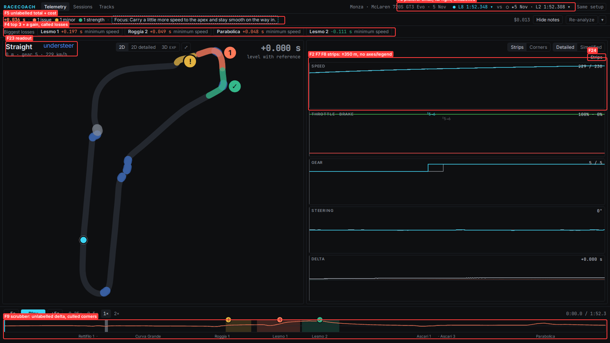
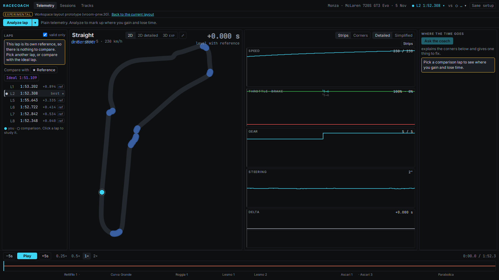
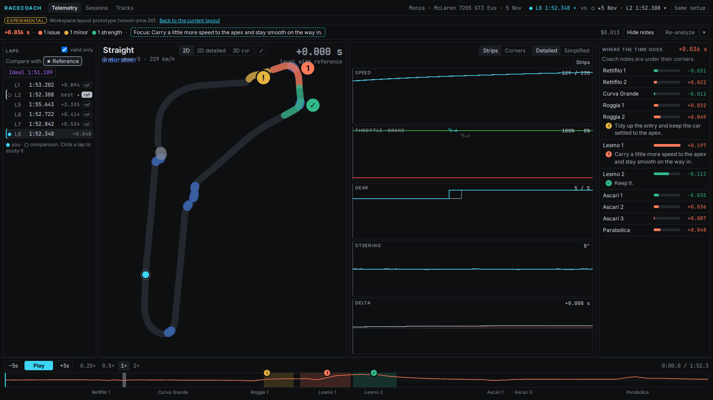

# UI review of the whole app (spike vroom-pnw.30)

**Question.** What makes the app hard to use today, and which UI direction should it take to fix that?

**Short answer.** The biggest problem is the first screen: it compares the reference lap with itself, so there is nothing to see. The next is that the two choices that drive everything — which lap and against what — are small, unlabelled text at the far right of the header. After that, the strips are a ±350 m window with no axes, and the Sessions page has two selection models and a stint table that ignores both. Recommended direction: **C, a workspace layout**. The session's laps sit in a rail on the left, "where the time goes" (every corner, with coach notes under it) sits in a rail on the right, and the map and strips stay in the middle. Ship it together with the handful of fixes from direction A that it doesn't cover. A clickable prototype runs behind `?ui=workspace`.

## How the review was done

- **Browser.** No browser MCP could be reached from this session. Claude in Chrome doesn't support WSL, and the built-in browser pane isn't available in a terminal session. So the review used **scripted Playwright screenshots**: Playwright 1.49.1 run from a scratch folder (not added to `package.json`) and its headless Chromium 131 with software WebGL (SwiftShader), at 1600×900 unless noted. Three environment workarounds were needed on this WSL machine (Ubuntu 26.04), noted here for whoever repeats this:
  - headless Chromium hangs before rendering unless `DBUS_SESSION_BUS_ADDRESS=disabled:` is set;
  - `libnss3`, `libnspr4` and `libasound2t64` were fetched with `apt-get download` and loaded with `LD_LIBRARY_PATH`, because there was no sudo;
  - the browser context needs an explicit `locale: "en-US"`, or the app throws "Incorrect locale information provided" and renders a blank page.
- **Data.** `npm run dev` with the MSW mock: Monza practice (5 Nov), Spa practice (3 Nov), the Monza race (9 Nov, stint stats only) and the other-car sessions.
- **Production view.** Screenshots started from `?debug=0`. Choosing a lap rewrites the URL to `?lap=…` and drops `?debug=0` (finding F11), so screenshots 13–17 show dev-only buttons (Run benchmark, Lose GPU context, HUD). Those buttons were not counted as clutter.
- **Reviewers.** The issue asked for Fable subagents for the per-area reviews. Every Fable call failed with "Fable 5.2 requires usage credits", so the same four briefs ran on **Opus subagents** instead: Telemetry and coach, strips and playback, track views, and Sessions/Tracks/narrow/errors. Each got its screenshots and the persona below, and this session merged, de-duplicated and ranked their findings.
- **Persona.** A sim racer who uses MoTeC i2 or Garage 61 regularly — knows lap vs reference, delta, throttle and brake traces — but has never seen this app.
- **Criteria.** Discoverability, information hierarchy and density against the theme rules (dark, dense: 6 px spacing, 4 px radius, 12 px Inter), navigation, consistency of controls, labels and wording, feedback for slow or failed actions, keyboard use.

### Coverage

| Page or flow | Status | Screenshots |
|---|---|---|
| Telemetry: default landing | reviewed | 01 |
| Picking a session | reviewed: Telemetry has no session picker, only Sessions → "Open →" (F3, F15) | 01, 10, 22 |
| Picking a lap and a comparison (reference, previous, ideal, other car) | reviewed | 02, 03, 04, 19 |
| Playback, transport, scrubber | reviewed | 04, 06, 08 |
| Strips and the Strips menu; Corners tab; Simplified view | reviewed | 09, 11, 12 |
| Annotations and the coach commands Analyze, Average, Corner ("Ask about this corner") | reviewed | 05, 06, 07, 08, 51, 52, 53 |
| Track panel: classic 2D | reviewed | 04, 06, 18 |
| Track panel: detailed 2D | reviewed | 13, 23 |
| Track panel: 3D with Chase, Cockpit and Top cameras, and the Car popover | reviewed. Orbit was left out: it is Chase with the camera circling, and it can't be judged from a still | 14, 15, 16, 17 |
| Expanded map | reviewed | 18 |
| Sessions page | reviewed | 10, 21, 25, 35 |
| Tracks page (corners, landmarks, re-calibrate) | reviewed. The landmark editor was judged from the page and code, not driven | 20, 24 |
| Stint view | reviewed | 10 |
| Ideal lap (as comparison, breakdown on Sessions) | reviewed | 19, 25 |
| Keyboard access | reviewed: tab order recorded, focus ring checked | 32 |
| Loading state | **partly**: the mock answers in a few milliseconds, so "Loading…" never showed in a screenshot (00 equals 01). Judged from code only | 00 |
| Error states | reviewed: unknown lap, unknown route | 30, 31 |
| Coach error (LLM failure) | **out of scope**: the mock coach never fails, and forcing a failure would need a contract or mock change, which the spike rules out. Judged from code (`AnalysisBar` shows `code: message`) | — |
| Narrow window | reviewed at 900 px and 420 px | 33, 34, 35 |

All screenshots are in `img/`. They show no driver name: the mock's driver field is the placeholder "Driver", and the UI doesn't render it.

## Findings, ranked

Severity is blocker (the user can't get value from the screen), major (costs real time or trust) or minor. "Seen" is what the persona sees; the code is cited only where it confirms the cause.

| # | Page | Sev. | What the user sees | Why it hurts | Suggested fix |
|---|---|---|---|---|---|
| F1 | Telemetry | **blocker** | The default landing opens L2, the reference lap, against itself: delta "+0.000 s level with reference", every strip a single flat trace, the comparison trigger "○ … ▾", no Biggest losses row (01). | The first screen shows nothing to analyse, and "…" looks like it is still loading. A new user concludes the app is empty. | Never land on a self-comparison. Open the newest non-reference flying lap against the reference. If lap and reference really are the same, say so and offer the ideal lap. |
| F2 | Telemetry · strips | major | The strips have no axes, no distance ticks and no units. They show a fixed ±350 m window around the playhead, so at 0 m on a straight they look flat (01, 04). There is no zoom and no full-lap mode. | A MoTeC or Garage 61 user reads the whole lap against distance and zooms into a corner. Here they can't tell how much track they're seeing, can't read a brake trace against a scale, and think the data is missing. | Add a slim distance axis, and a window control (corner / 700 m / lap) with fit-to-corner on a corner click. Open on the first braking zone, not 0 m. |
| F3 | Telemetry · header | major | The lap and comparison pickers are bare mono text ("● L8 1:52.348 ▾ vs ○ ★5 Nov · L2 …") at the far right of the top bar, next to plain-text session info that can't be clicked (01, 04, 50). | These two choices drive every number on the page, yet they read like a status line. There is no way to change session from Telemetry. | Give lap, comparison and session labelled, visible controls on the left of the work area (direction C does this with a lap rail). |
| F4 | Telemetry | major | "Biggest losses" shows the top 3 corners and one gain styled like the losses (Lesmo 2 −0.111). A −0.001 s "gain" can also appear. Cause words ("minimum speed") don't say which way (04, 06). | The only free "where is the time" answer is partial and mislabelled, and the full per-corner picture is hidden in the Corners tab. | One corner-by-corner list of time lost and gained, in track order, with coach notes slotted under their corners (direction C's right rail). Phrase causes as "lower min speed" or "braked earlier". |
| F5 | Telemetry · Analysis bar | major | After Analyze: "+0.036 s · ● 1 issue … $0.013" with no labels. The header lap times differ by 0.040 s (06). | The total disagrees with the lap times (it is the last delta sample), and the bare dollar figure reads like a charge. | Label it "Lap Δ" and make it agree with the lap-time gap. Show "Coach cost $0.013" with a tooltip. |
| F6 | Telemetry · readout | major | Against the ideal lap the delta shows a red "+0.010 s" while the caption under it says "level with reference" (19). The comparison is always called "reference", even when it is the ideal or the previous lap. | The caption contradicts the number, which costs trust on the first reading. | Use the same threshold for caption and number, and name the comparison ("behind ideal", "ahead of L7"). |
| F7 | Telemetry · strips | major | Strip headers collide with the traces: the 100% throttle line strikes through "THROTTLE · BRAKE" and "230 / 230", and gear-shift labels pile into the header (04, 08, 09). | The most-read strip looks broken. | Reserve a header band, or give labels a solid chip; keep shift labels below the band. |
| F8 | Telemetry · strips | major | Nothing says which line is you and which is the comparison (cyan vs thin grey). Readouts are a bare "119 / 121" (08). | Reading lap against reference depends on guessing. | A small legend ("You L8", "Ref L2") and readouts coloured like their lines. |
| F9 | Telemetry · scrubber | major | The scrubber's orange line (the time delta) and grey blocks have no label. The scrubber runs on time while the strips run on distance. Corner labels are culled ("·"), so Rettifilo 2, Roggia 2 and Ascari 2 are missing even when Biggest losses names them (06, 08). | The overview trace can't be read, and named losses can't be found on the timeline. | Label "Δ to comparison" with a zero line. Keep labels for corners that have a finding. Use short corner codes when space is tight. |
| F10 | Telemetry · keyboard | major | Space and the arrow keys work only while the strips have focus, and the shortcuts are written only in an aria-label. Tab walks ~10 corner-tick buttons, and corners hidden by label culling are unreachable (32). | Keyboard users can't play, pause or step from anywhere, and sighted users never learn the shortcuts. | Page-wide Space, ←/→ and J/K/L outside inputs, a "?" shortcuts popover, and a roving-tabindex tick group that includes hidden ticks. |
| F11 | All | major | Choosing a lap or comparison replaces the whole query string, so `?debug=0`, `?balance`, `?mirror=0` (and this prototype's `?ui`) are dropped (14–17). | Flags documented in CLAUDE.md silently stop working after the first click, and dev buttons reappear in what should be the production view. | Update `lap`/`ref` and keep the other params. |
| F12 | Telemetry · errors | major | `?lap=nope` shows "unknown_lap: No lap nope" in grey on an empty page. The pickers and analysis bar are gone (30). | It is developer text, and the user has no way forward. | "That lap no longer exists", with "Open latest lap" and "Sessions" buttons. |
| F13 | Sessions | major | Monza McLaren opens with the lap table on "9 Nov · Race", which reads "No valid flying lap to build an ideal lap from" although the race has 22 valid laps. The race row shows "—" under Open with no visible reason (10). | The first view says the data is broken; the real reason (stint stats only, no traces) is hidden in a tooltip. | Default to the newest session with traces. Tag trace-less sessions "stats only" and point them to their Stint view. |
| F14 | Sessions · Stint | major | With "5 Nov · Practice" selected, the STINT panel still shows "Race · 9 Nov · 25 laps". It renders for every session of the combo and makes the page ~1000 px longer (25). | The user thinks the stint belongs to the practice they picked. | Tie the Stint panel to the selected session, or put Laps / Ideal / Stint on tabs under one session selector. |
| F15 | Sessions | major | Two identical-looking chip rows (track+car at the top, date·type below). The session table rows look selectable but do nothing; only "Open →" works, and it opens the best lap only (10, 25). | Two selection models with no visible link, and no way to open a chosen lap of a session. | Make table rows select the session and drop the second chip row. Let the lap table open any lap in Telemetry. |
| F16 | Sessions | major | "Gap to theoretical —" because the newest session is the race; "Change since first +0.139 s" in red compares a race best with a practice best (10). | The headline cards look empty or alarming because of session type, not pace. | Compute over comparable sessions, or name the session the value comes from. |
| F17 | Telemetry · Corners | major | The Corners table is wider than the panel: Coast, Overlap and Steer corr. are off to the right with no scroll cue. Each cell stacks three unlabelled numbers (you / ref / diff) (11). | A third of the metrics are never found, and three-line cells are slow to scan. | Pin the Corner column, add a scroll shadow, and show only the diff by default. |
| F18 | Telemetry · map | major | The classic map is covered in blue and grey blobs (understeer, close calls) with no legend. On Spa the blue understeer tint is louder than the coach's issue badges, and the grey blobs look like a second car (04, 22). | The marks can't be decoded, and they compete with the coach. | A real legend in a corner of the panel. A quieter understeer tint, and a close-call colour that doesn't look like the reference car. |
| F19 | Track views | major | In detailed 2D and 3D, the toggles (Heading-up, Line ahead, Split, HUD) look exactly like one-shot buttons (Fit, Car); there is no pressed style (13–16). | The user can't tell what state the view is in. | Use the `.toggleItem[data-state=on]` look, or Radix Toggle. |
| F20 | Track views | major | The detailed 2D toolbar is two wrapped rows of ~10 controls, and captions split from their groups ("EDGES" at the end of one line, its buttons on the next). "EXPERIMENTAL" sits after Split in 3D but before its control in 2D. "No elevation for this track" looks like a button (13, 14, 23). | It is cluttered, inconsistent, and full of jargon (Stand-in, Survey, Beside). | Keep caption and group together. Move rare options into a "View options" popover. Show notes as muted text. |
| F21 | Track views · 3D | major | In the Cockpit camera the rear-view mirror and the toolbar sit on top of the corner/speed readout and the delta caption (15). | Key numbers are unreadable in the view a racer is most likely to try. | Move the mirror below the toolbar, and give the readout a solid chip in 3D. |
| F22 | Tracks | major | Corner names overlap on the map (Rettifilo 1/2, Roggia 1/2, Ascari 2/3, Fagnes 1/2), and the right half of the map panel is empty (20, 24). | The page for locating landmarks is unreadable at the chicanes. | Collision-avoiding labels or leader lines, and fit the map to the panel. |
| F23 | Telemetry · readout | minor | "Straight understeer" in large blue at 0 m. The readout shows only your speed, not the reference's (01, 04). At narrow widths the label overlaps the distance line (33, 42). | A balance verdict where nobody is cornering, and the "you vs ref" pair a racer expects is missing. | Show balance only inside corners, smaller. Show "229 / 230 km/h". |
| F24 | Telemetry · inputs | minor | The tab is called "Strips" and the picker button below it is also "Strips". Two identical toggle groups sit side by side (Strips\|Corners, Detailed\|Simplified). The tab choice resets on reload (01, 09). | It reads as four peer tabs with a duplicate name. | Real tabs for Strips/Corners, "Choose strips" on the picker, and remember the tab. |
| F25 | Telemetry · annotations | minor | The card opens on hover and covers the strips. It shows a "FEEL" tag with no explanation. Badges mix "1", "!", "✓" and "~". After Average, two "~" badges overlap at Rettifilo (07, 52). After "Ask about this corner", the headless run found the card closed: the answer lives inside the hover card and stays hidden until the badge is hovered again (53; verify by hand). | Cards open by accident, the glyphs need guessing, and the paid answer may go unseen. | Open on click, preview on hover after a delay. Explain the glyphs in the Analysis bar. Show deep-dive answers somewhere that persists (direction C: under the corner). |
| F26 | Telemetry · coach | minor | While Analyze runs, the button becomes "Analyzing… computing corner facts, then asking the Engineer" with no progress and no cancel. Errors show as raw `code: message` (05; code). | A paid, slow call with no control, and failures that read like a stack trace. | Spinner and Cancel, and a plain-sentence error with Retry. |
| F27 | Telemetry · menus | minor | The comparison menu lists in-laps, out-laps and other-car laps among the real candidates. "Reference lap (default)" doesn't say which lap it is. The lap menu shows "+1.199 ideal best" next to an unexplained segment strip (02, 03). | Noise, and the two menus use different wording for the same things. | Hide in/out laps from comparisons, group other cars, and name the reference lap. |
| F28 | Telemetry · transport | minor | Stepping is only ±5 s or dragging, with no previous/next corner or next issue. The clock shows time only (06). | Coaching is corner by corner; ±5 s lands mid-straight. | ◀ ▶ corner and issue steps, and the distance next to the clock. |
| F29 | Telemetry · inputs | minor | Only the Corner header looks sortable. "−0" appears, and the reference's "Min speed at" reads "0 m before apex" in every row. The Simplified view shows wheels and bars with no numbers (11, 12). | Noise, and sorting by loss can't be found. | One sort-arrow style, sort by Time lost after Analyze, and numbers on the Simplified bars. |
| F30 | Track views | minor | In Chase, both cars are one two-tone box. In Top, the car is a 3 px dot. Detailed 2D opens zoomed on ~300 m of plain road with no scale or corner name (13, 14, 16). | It looks broken or lost. | Ghost or offset the reference car, give the car marker a minimum size, add a scale bar and the next corner's name. |
| F31 | Track views | minor | The Car popover has developer copy ("SOURCE Box", Sketchfab, gltf, a CLI script). The expand button is a bare ⤢ with no tooltip. The EngineerLine footer appears only while inside a corner with a finding (17, 18; code). | Unclear controls, and the coach's main advice line is easy to miss. | User-facing copy, tooltips, and show the next finding while paused. |
| F32 | Sessions | minor | The trend chart has no x dates and doesn't say that faster is up. The ideal breakdown is clipped mid-row with no scroll cue, and its rows don't look clickable. The Segments column has no legend. The stint cards lack units ("RANGE 27.8 fuel") (10, 21, 25). | Good features go unfound or are misread. | Axis labels, scroll shadows, "→" on link rows, legends and units. |
| F33 | Tracks | minor | Landmark rows have no corner name and aren't in distance order. Kinds show raw enums (`brake_board`). The only primary button is the rare "Re-calibrate from ★ reference". Delete has no undo (20, 24). | Slow to audit, and misplaced emphasis. | Group by corner, sort by distance, use readable kinds, make Re-calibrate secondary, and add an undo toast. |
| F34 | All · narrow | minor | At 420 px the map overlays collide and the header pickers wrap to three lines; at 900 px the stint cards wrap unevenly (33, 34, 35). | It looks broken in a split screen next to the sim. | Stack the overlays below a breakpoint, and give the cards a fixed grid. |

**What works well** (keep it in any direction): colour-matched corner and finding bands across map, strips and scrubber; the Biggest losses chips work before any LLM call and seek to the corner; the focus ring and aria-labels are clear; the cockpit dash reads like a real car display; the Sessions table and the ideal-lap breakdown with deep links follow the MoTeC / Garage 61 way of working.



## Root causes

Most findings trace back to three things:

1. **The comparison is the app's core, but it has no home.** Lap, comparison and session live in a header slot as text (F1, F3, F6, F11, F27), and the Sessions page has its own competing selection (F13–F15).
2. **"Where is the time" is answered in four places that don't agree:** the Biggest losses row, the Analysis bar counts, the Corners tab and the scrubber (F4, F5, F9, F17). The coach's output is spread over hover cards and a footer that appears only mid-corner (F25, F31).
3. **Labels and state are missing at the control level:** axes, legends, pressed states, units (F2, F7, F8, F18, F19, F20).

## Directions

### A. Keep the layout, fix the top findings

Fix the findings in place: the default landing (F1), keeping URL params (F11), labels, legends and axes (F2, F5–F9, F18, F19), the error page (F12), the Sessions selection and stint tie-in (F13–F15), and the rest as small issues.

- **Fixes:** F1, F2, F5–F21, most minors. F3 and F4 only partly: the pickers get bigger, but they stay in the header, and the losses stay a row.
- **Mock-up:** the annotated screenshot above; each box is a local fix.
- **Cost:** about 10 small build issues, each half a day to a day; no new components.
- **Risk:** low. But the two structural problems (root causes 1 and 2) stay, so the app stays "a dense screen you have to learn".

### B. Guided review: session → lap → coach → corner

A step flow:
1. Pick a session (cards, newest first).
2. Pick a lap, with the comparison chosen for you (best other lap or ideal) and changeable.
3. A coach summary page: total delta, corners ranked, "Ask the coach".
4. Drill into one corner: map, strips and playback scoped to that corner.

```
 ┌ 1 Session ─┐   ┌ 2 Lap ───────────────┐   ┌ 3 Summary ───────────────┐   ┌ 4 Corner: Lesmo 1 ─────────┐
 │ Monza  5 Nov│ → │ L8 1:52.348  vs  ★L2 │ → │ +0.036 s                 │ → │ map (zoomed) │ strips ±corner│
 │ Spa    3 Nov│   │ L6 1:52.722          │   │ Lesmo 1   +0.197 ▇▇▇▇    │   │ coach note, fix, evidence  │
 │ Monza  9 Nov│   │ L7 1:52.842   [Next] │   │ Roggia 2  +0.049 ▇       │   │ ◀ prev corner  next ▶      │
 └─────────────┘   └──────────────────────┘   │ [Ask the coach]          │   └────────────────────────────┘
                                              └──────────────────────────┘
```

- **Fixes:** F1, F3, F4, F13–F15 thoroughly. F2 by scoping strips to a corner. F25 and F28 by design.
- **Cost:** high. Four new screens and routes, the playback store reused per step, and the Sessions page reworked. Roughly 3–4 weeks.
- **Risk:** high. It slows repeat users (the persona knows what they want), it hides the full-lap view that MoTeC and Garage 61 users expect, and it fits poorly with v3 live coaching, where the screen is a dashboard rather than a wizard. It also goes against the spec's "dense" theme.

### C. Workspace with a lap rail and a corner rail (recommended)

Keep the centre exactly as it is (map, inputs, transport) and add two rails:

- **Lap rail (left):** the session's laps as a list, MoTeC / Garage 61 style, with time and gap to best. Click a row to study it; "ref" on a row makes it the comparison. Quick picks: ★ Reference and Ideal. A plain-language hint when the lap is its own reference.
- **Corner rail (right), "Where the time goes":** every corner in track order with a gain/loss bar and its delta, free from the comparison. "Ask the coach" sits at the top, and after Analyze each finding's fix sits under its corner. Click a corner to seek to it. This replaces the Biggest losses row.

| Landing (lap is its own reference) | After picking L8 and asking the coach |
|---|---|
|  |  |

More: `img/41-ws-lap-vs-ref.png`, `img/43-ws-seek-corner.png`, `img/44-ws-vs-ideal.png`, `img/45-ws-1100.png` (rails stack below 1100 px).

- **Fixes:** F1 (the hint plus one click to fix it; the landing default still needs A's fix), F3, F4, F25 (the fix text persists under the corner), half of F6 (the comparison is always visible and named). It also opens the way to F13–F15: the lap rail can take a session selector, and the Sessions page can become history only.
- **Cost:** medium. Two components already exist as the prototype (~250 lines). Building it for real: a session selector in the rail, removing the header pickers and the Biggest losses row, keyboard support for the rails, a narrow-window layout, and tests. About 1–1.5 weeks, plus the A fixes it doesn't cover (F2, F5, F7–F12, F18–F21).
- **Risks:**
  - It takes ~460 px of width. The map and strips get narrower, and at 1600 px the map readout already collides (F23, visible in 42). That has to be fixed with it.
  - Below ~1100 px the corner rail drops under the centre, so on a laptop the rails need to collapse.
  - It duplicates the header pickers until those are removed.
  - The corner rail lists every corner, which is long on Spa (about 20 corners); it may need a "losses only" filter.

**Recommendation: C, plus the A fixes it doesn't cover.** C fixes the two structural root causes at medium cost and keeps the dense, tool-like character the spec asks for; A alone leaves them; B is costly and works against the persona.

## Prototype

- **Where:** `npm run dev`, then open `http://localhost:5173/?ui=workspace`. An "EXPERIMENTAL" banner names the prototype and links back to the current layout.
- **Code:**
  - `frontend/src/components/workspace/LapRail.tsx`, `CornerRail.tsx` and `Workspace.module.css`.
  - `TelemetryPage.tsx` renders the rails only when `ui=workspace`, and keeps the flag in the URL on lap and comparison changes. Without the flag, the page renders exactly as before; tests cover both.
- **Data:** only through the existing `Api` hooks. No contract change.
- **Not done:** keyboard navigation inside the rails beyond Tab, a session selector, removing the header pickers, mobile layout.

## Decision question

**Keep, change or drop the workspace direction (C) as the target layout for the Telemetry page?**

- **Keep:** file the build issues below and start with the landing fix and URL params.
- **Change:** say which part (for example lap rail yes, corner rail no).
- **Drop:** go with direction A only; the prototype is removed and this write-up stays.

## Draft follow-up build issues (for direction C)

| Type | Title | Acceptance |
|---|---|---|
| bug | Telemetry never lands on a lap compared with itself | With no `?lap`, the page opens the newest valid flying lap that isn't the reference, against the reference. When lap and comparison are the same lap, a visible note says so and offers the ideal lap. Test covers both. |
| bug | Choosing a lap or comparison keeps the other URL params | `debug`, `balance`, `mirror` (and any other param) survive lap and comparison changes. Test. |
| feature | Lap rail on the Telemetry page (from the vroom-pnw.30 prototype) | A left rail lists the session's laps (time, gap to best, valid-only filter), with a session selector, ★ Reference and Ideal quick picks and per-row "ref". The header pickers are removed. Keyboard: arrows move through rows, Enter selects, R sets the comparison. Collapses below 1100 px. Tests. |
| feature | "Where the time goes" corner rail replaces Biggest losses | Every corner in track order with its delta and a bar. Clicking seeks to the corner. "Ask the coach" at the top. After Analyze or Average, each finding's fix sits under its corner, and deep-dive answers ("Ask about this corner") show there too. A "losses only" filter. Tests. |
| feature | Strips: distance axis, window control, you/ref legend | A distance axis under the last strip; a window control (corner / 700 m / lap); a legend naming the lap and the comparison; headers no longer collide with traces at 100%. Tests for the window maths. |
| task | Sessions: one session selector; lap table and stint follow it | Table rows select the session and the second chip row is gone. The lap table and Stint panel show only the selected session. Trace-less sessions are tagged "stats only" and default to their stint. Any lap opens in Telemetry. |
| task | Legend for map marks, and pressed state for track-view toggles | The classic map has a legend for understeer, close call, lockup and wheelspin. Toggle buttons in the detailed 2D and 3D views show their on state. The 3D cockpit mirror no longer covers the readout. |
| bug | Unknown-lap link shows a way forward | `?lap=<unknown>` shows "That lap no longer exists" with "Open latest lap" and "Sessions" actions, and keeps the header. Test. |
| feature | Page-wide playback keys and a shortcuts popover | Space, ←/→ and J/K/L work outside inputs; a "?" popover lists them; corner ticks are a roving-tabindex group that includes hidden ticks. |
